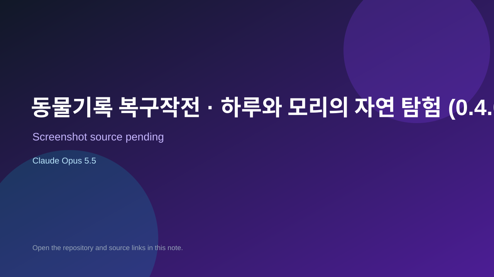

# 동물기록 복구작전 · 하루와 모리의 자연 탐험 (0.4.0)

> Verified game note.

## At a glance

- **Score:** 7.5/10
- **Model:** Claude Opus 5.5
- **Technology:** JavaScript, Browser
- **Estimated FP32 operations/s at 60 FPS:** 1,000,000,000 (low confidence; static estimate, not measured).
- **Rating basis:** Heuristic from source size, README and commit history (5.8 + 0.6*log10(code KB+1), +0.3 with a reachable demo); no runtime playtest.
- **Verified:** 2026-10-17
- **Repository:** [https://github.com/yelmovie/animal-record-recovery](https://github.com/yelmovie/animal-record-recovery)
- **Evidence:** [direct model evidence](https://github.com/yelmovie/animal-record-recovery/commit/8d1fda56c47e3826ca3f2e0200d4b027a05f1549)
- **Live demo:** [open demo](https://animal-record-recovery.vercel.app)

## Screenshots

No screenshot source is recorded yet. Keep the placeholder until a repository, awesome list, or creator source provides an image.

## Model attribution

Open the evidence link above. Evidence grade: **direct model evidence**.

## Source description

Animal Record Recovery: an elementary science game on "Animal Life". Explore 5 places with Haru and Mori through 20 inquiry activities: observe, classify, infer habitats, and invent. Runs on Node.js with no dependencies. Commit carries an exact Claude Opus 5.5 co-author trailer. Live demo returned HTTP 200 (availability only, not a playtest). Source inspected from README, file tree and commit history only; no playtest.

### Gameplay source

- [https://github.com/yelmovie/animal-record-recovery/blob/main/src/app.js](https://github.com/yelmovie/animal-record-recovery/blob/main/src/app.js)
- [https://github.com/yelmovie/animal-record-recovery/commit/8d1fda56c47e3826ca3f2e0200d4b027a05f1549](https://github.com/yelmovie/animal-record-recovery/commit/8d1fda56c47e3826ca3f2e0200d4b027a05f1549)

## Verification notes

- **Status:** verified_source
- **Counted units in repository:** 1
- **Units covered by this note:** 1
- **Discovery:** GitHub commit pool: model+game commits 2026-10-16..2026-10-17 (1-hour Opus, 3-hour Sonnet, 6-hour other UTC partitions) joined to repositories created after 2026-10-16T00:00Z; https://github.com/yelmovie/animal-record-recovery

[Back to the awesome list](../../README.md)
