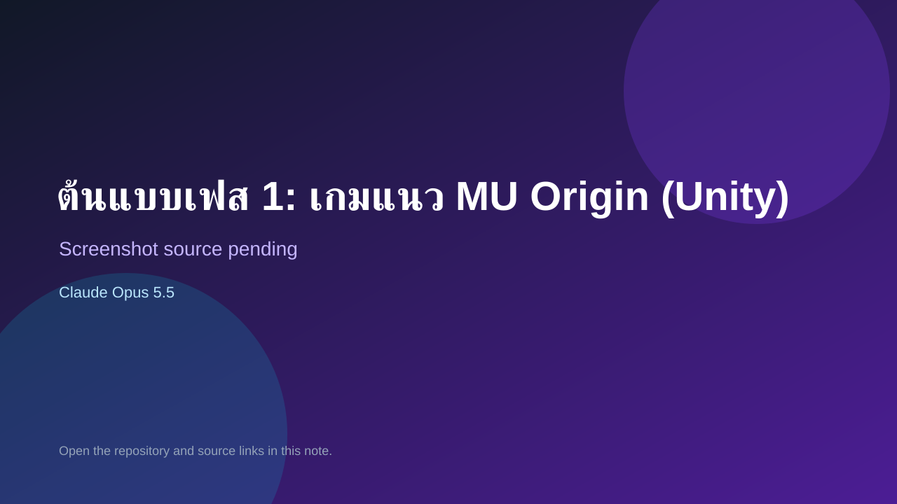

# ต้นแบบเฟส 1: เกมแนว MU Origin (Unity)

> Verified game note.

## At a glance

- **Score:** 6.8/10
- **Model:** Claude Opus 5.5
- **Technology:** Unity, C#
- **Estimated FP32 operations/s at 60 FPS:** 1,000,000,000 (low confidence; static estimate, not measured).
- **Rating basis:** Heuristic from source size, README and commit history (5.8 + 0.6*log10(code KB+1), +0.3 with a reachable demo); no runtime playtest.
- **Verified:** 2026-10-17
- **Repository:** [https://github.com/Tomqre01/MMORPG](https://github.com/Tomqre01/MMORPG)
- **Evidence:** [direct model evidence](https://github.com/Tomqre01/MMORPG/commit/5b92f168827c974f7f6b69f5c8c97a810b2159cd)

## Screenshots

No screenshot source is recorded yet. Keep the placeholder until a repository, awesome list, or creator source provides an image.

## Model attribution

Open the evidence link above. Evidence grade: **direct model evidence**.

## Source description

ต้นแบบเล่นคนเดียว ใช้รูปทรงพื้นฐานแทนงานภาพ เพื่อทดสอบว่าลูป "ตีมอน → ได้ของ → อัปพลัง" สนุกไหม. Commit carries an exact Claude Opus 5.5 co-author trailer. Source inspected from README, file tree and commit history only; no playtest.

### Gameplay source

- [https://github.com/Tomqre01/MMORPG/blob/main/Assets/Scripts/HUD.cs](https://github.com/Tomqre01/MMORPG/blob/main/Assets/Scripts/HUD.cs)
- [https://github.com/Tomqre01/MMORPG/commit/5b92f168827c974f7f6b69f5c8c97a810b2159cd](https://github.com/Tomqre01/MMORPG/commit/5b92f168827c974f7f6b69f5c8c97a810b2159cd)

## Verification notes

- **Status:** verified_source
- **Counted units in repository:** 1
- **Units covered by this note:** 1
- **Discovery:** GitHub commit pool: model+game commits 2026-10-16..2026-10-17 (1-hour Opus, 3-hour Sonnet, 6-hour other UTC partitions) joined to repositories created after 2026-10-16T00:00Z; https://github.com/Tomqre01/MMORPG

[Back to the awesome list](../../README.md)
