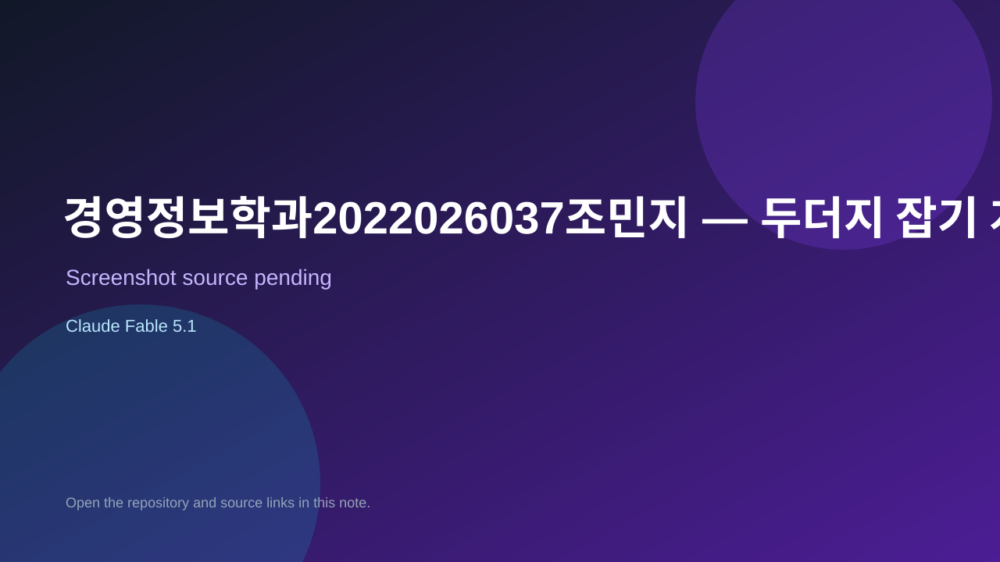

# 경영정보학과2022026037조민지 — 두더지 잡기 게임

> Verified game note.

## At a glance

- **Score:** 7.0/10
- **Model:** Claude Fable 5.1
- **Technology:** TypeScript, React, Browser
- **Estimated FP32 operations/s at 60 FPS:** 10,000,000 (low confidence; static estimate, not measured).
- **Rating basis:** Heuristic from source size, README and commit history (5.8 + 0.6*log10(code KB+1), +0.3 with a reachable demo); no runtime playtest.
- **Verified:** 2026-10-21
- **Repository:** [https://github.com/wawalswl-ship-it/mole_game](https://github.com/wawalswl-ship-it/mole_game)
- **Evidence:** [direct model evidence](https://github.com/wawalswl-ship-it/mole_game/commit/0baa9c741e5e0b6ee9364f6d5a41c7fc6c4c1838)
- **Live demo:** [open demo](https://mole-game-pied.vercel.app)

## Screenshots

No screenshot source is recorded yet. Keep the placeholder until a repository, awesome list, or creator source provides an image.

## Model attribution

Open the evidence link above. Evidence grade: **direct model evidence**.

## Source description

React + Vite + Supabase 로 만든 두더지 잡기 웹사이트입니다. Commit carries an exact Claude Fable 5.1 co-author trailer. Live demo returned HTTP 200 (availability only, not a playtest). Source inspected from README, file tree and commit history only; no playtest.

### Gameplay source

- [https://github.com/wawalswl-ship-it/mole_game/blob/main/src/App.tsx](https://github.com/wawalswl-ship-it/mole_game/blob/main/src/App.tsx)
- [https://github.com/wawalswl-ship-it/mole_game/commit/0baa9c741e5e0b6ee9364f6d5a41c7fc6c4c1838](https://github.com/wawalswl-ship-it/mole_game/commit/0baa9c741e5e0b6ee9364f6d5a41c7fc6c4c1838)

## Verification notes

- **Status:** verified_source
- **Counted units in repository:** 1
- **Units covered by this note:** 1
- **Discovery:** GitHub commit pool: model+game commits 2026-10-17T01:00Z..2026-10-21T01:00Z (1-hour Opus, 3-hour Sonnet, 6-hour other UTC partitions) joined to repositories created after 2026-10-17T00:00Z; https://github.com/wawalswl-ship-it/mole_game

[Back to the awesome list](../../README.md)
