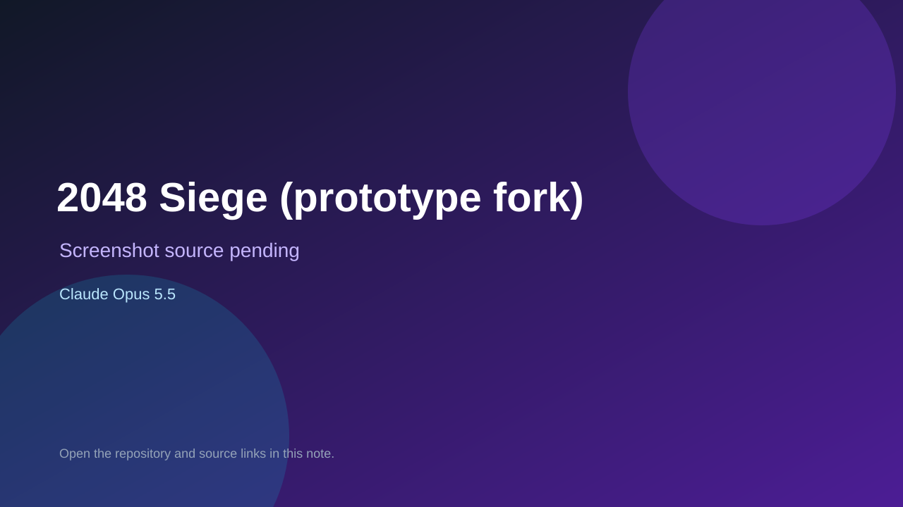

# 2048 Siege (prototype fork)

> Top-list entry: **today** (#1), **this week** (#1), **this month** (#1).

## At a glance

- **Score:** 8.6/10
- **Model:** Claude Opus 5.5
- **Technology:** JavaScript, PixiJS, Browser
- **Estimated FP32 operations/s at 60 FPS:** 100,000,000 (low confidence; static estimate, not measured).
- **Rating basis:** Heuristic from source size, README and commit history (5.8 + 0.6*log10(code KB+1), +0.3 with a reachable demo); no runtime playtest.
- **Verified:** 2026-10-17
- **Repository:** [https://github.com/jun0e/2048-siege](https://github.com/jun0e/2048-siege)
- **Evidence:** [direct model evidence](https://github.com/jun0e/2048-siege/commit/afb684c5d270d9f68e4d137208eab6fbe25fa92f)
- **Live demo:** [open demo](https://jun0e.github.io/2048-siege/)

## Screenshots

No screenshot source is recorded yet. Keep the placeholder until a repository, awesome list, or creator source provides an image.

## Model attribution

Open the evidence link above. Evidence grade: **direct model evidence**.

## Source description

2048 Siege: a 2048 merge + lane tower-defense game for phones (PixiJS). Commit carries an exact Claude Opus 5.5 co-author trailer. Live demo returned HTTP 200 (availability only, not a playtest). Source inspected from README, file tree and commit history only; no playtest.

### Gameplay source

- [https://github.com/jun0e/2048-siege/blob/main/2048-siege-kv.html](https://github.com/jun0e/2048-siege/blob/main/2048-siege-kv.html)
- [https://github.com/jun0e/2048-siege/commit/afb684c5d270d9f68e4d137208eab6fbe25fa92f](https://github.com/jun0e/2048-siege/commit/afb684c5d270d9f68e4d137208eab6fbe25fa92f)

## Verification notes

- **Status:** verified_source
- **Counted units in repository:** 1
- **Units covered by this note:** 1
- **Discovery:** GitHub commit pool: model+game commits 2026-10-16..2026-10-17 (1-hour Opus, 3-hour Sonnet, 6-hour other UTC partitions) joined to repositories created after 2026-10-16T00:00Z; https://github.com/jun0e/2048-siege

[Back to the awesome list](../../README.md)
