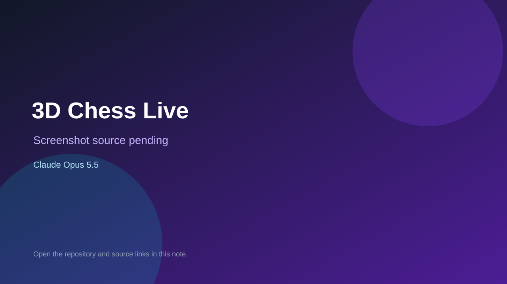

# 3D Chess Live

> Verified game note.

## At a glance

- **Score:** 7.0/10
- **Model:** Claude Opus 5.5
- **Technology:** JavaScript, Browser
- **Estimated FP32 operations/s at 60 FPS:** 1,000,000,000 (low confidence; static estimate, not measured).
- **Rating basis:** Heuristic from source size, README and commit history (5.8 + 0.6*log10(code KB+1), +0.3 with a reachable demo); no runtime playtest.
- **Verified:** 2026-10-21
- **Repository:** [https://github.com/roblisagrossman-hue/Chess3d-live](https://github.com/roblisagrossman-hue/Chess3d-live)
- **Evidence:** [direct model evidence](https://github.com/roblisagrossman-hue/Chess3d-live/commit/5e886008c4d112336d2bf6482dc5dd1db9f3561c)

## Screenshots

No screenshot source is recorded yet. Keep the placeholder until a repository, awesome list, or creator source provides an image.

## Model attribution

Open the evidence link above. Evidence grade: **direct model evidence**.

## Source description

3D chess for Windows and Android. Play a friend over the internet with live video, voice and shared music, or play the computer offline. Commit carries an exact Claude Opus 5.5 co-author trailer. Source inspected from README, file tree and commit history only; no playtest.

### Gameplay source

- [https://github.com/roblisagrossman-hue/Chess3d-live/blob/main/www/js/app.js](https://github.com/roblisagrossman-hue/Chess3d-live/blob/main/www/js/app.js)
- [https://github.com/roblisagrossman-hue/Chess3d-live/commit/5e886008c4d112336d2bf6482dc5dd1db9f3561c](https://github.com/roblisagrossman-hue/Chess3d-live/commit/5e886008c4d112336d2bf6482dc5dd1db9f3561c)

## Verification notes

- **Status:** verified_source
- **Counted units in repository:** 1
- **Units covered by this note:** 1
- **Discovery:** GitHub commit pool: model+game commits 2026-10-17T01:00Z..2026-10-21T01:00Z (1-hour Opus, 3-hour Sonnet, 6-hour other UTC partitions) joined to repositories created after 2026-10-17T00:00Z; https://github.com/roblisagrossman-hue/Chess3d-live

[Back to the awesome list](../../README.md)
