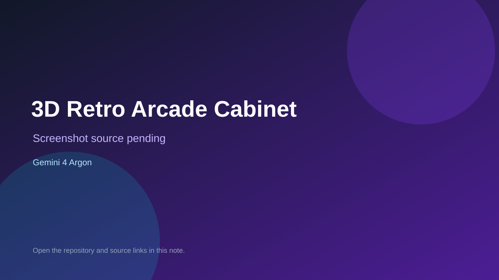

# 3D Retro Arcade Cabinet

> Verified game note.

## At a glance

- **Score:** 6.9/10
- **Model:** Gemini 4 Argon
- **Technology:** JavaScript, Browser
- **Estimated FP32 operations/s at 60 FPS:** 10,000,000 (low confidence; static estimate, not measured).
- **Rating basis:** Heuristic from source size, README and commit history (5.8 + 0.6*log10(code KB+1), +0.3 with a reachable demo); no runtime playtest.
- **Verified:** 2026-10-17
- **Repository:** [https://github.com/minjun1177/gemini-4-argon-demo](https://github.com/minjun1177/gemini-4-argon-demo)
- **Evidence:** [inferred model evidence](https://github.com/minjun1177/gemini-4-argon-demo)

## Screenshots

No screenshot source is recorded yet. Keep the placeholder until a repository, awesome list, or creator source provides an image.

## Model attribution

Open the evidence link above. Evidence grade: **inferred model evidence**.

## Source description

Testing argon. Only the repository name and description ("Testing argon") point to Gemini 4 Argon, so the model is inferred. Source inspected from README, file tree and commit history only; no playtest.

### Gameplay source

- [https://github.com/minjun1177/gemini-4-argon-demo/blob/main/game2d.js](https://github.com/minjun1177/gemini-4-argon-demo/blob/main/game2d.js)
- [https://github.com/minjun1177/gemini-4-argon-demo](https://github.com/minjun1177/gemini-4-argon-demo)

## Verification notes

- **Status:** verified_source
- **Counted units in repository:** 1
- **Units covered by this note:** 1
- **Discovery:** GitHub repository search: exact model phrase, created 2026-10-16T00:00Z..2026-10-17T01:30Z; https://github.com/minjun1177/gemini-4-argon-demo

[Back to the awesome list](../../README.md)
