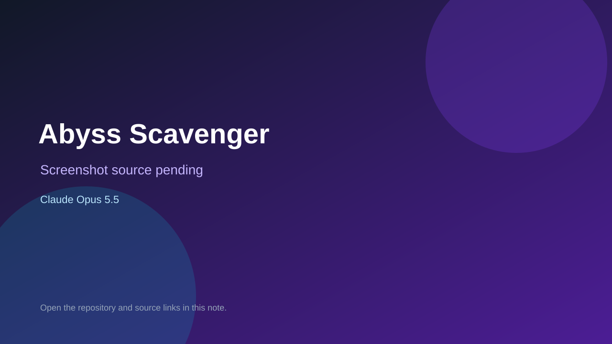

# Abyss Scavenger

> Verified game note.

## At a glance

- **Score:** 7.4/10
- **Model:** Claude Opus 5.5
- **Technology:** HTML, JavaScript, Canvas, Browser
- **Estimated FP32 operations/s at 60 FPS:** 100,000,000 (low confidence; static estimate, not measured).
- **Rating basis:** Estimated from README, source tree and commit history; no runtime playtest.
- **Verified:** 2026-10-15
- **Repository:** [https://github.com/Foremanytz/AbyssScavenger](https://github.com/Foremanytz/AbyssScavenger)
- **Evidence:** [direct model evidence](https://github.com/Foremanytz/AbyssScavenger/commit/918cfbe1decc5f70389064358ea5531752206a1c)
- **Live demo:** [open demo](https://foremanytz.github.io/AbyssScavenger/)

## Screenshots

No screenshot source is recorded yet. Keep the placeholder until a repository, awesome list, or creator source provides an image.

## Model attribution

Open the evidence link above. Evidence grade: **direct model evidence**.

## Source description

Traditional-Chinese roguelike in a single HTML file (abyss-scavenger.html, ~125 KB); commits carry exact Claude Opus 5.5 co-author trailers and the description says it was made by Claude Opus 5.5. Live demo returned HTTP 200 (availability only, not a playtest). Source inspected only; no playtest.

### Gameplay source

- [https://github.com/Foremanytz/AbyssScavenger/blob/main/abyss-scavenger.html](https://github.com/Foremanytz/AbyssScavenger/blob/main/abyss-scavenger.html)
- [https://github.com/Foremanytz/AbyssScavenger/commit/918cfbe1decc5f70389064358ea5531752206a1c](https://github.com/Foremanytz/AbyssScavenger/commit/918cfbe1decc5f70389064358ea5531752206a1c)

## Verification notes

- **Status:** verified_source_and_live_demo
- **Counted units in repository:** 1
- **Units covered by this note:** 1
- **Discovery:** GitHub repository search: exact model phrase, created 2026-10-08..2026-10-15 (UTC partitions); https://github.com/Foremanytz/AbyssScavenger

[Back to the awesome list](../../README.md)
