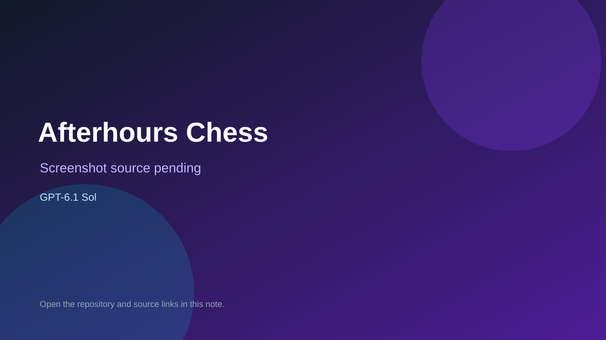

# Afterhours Chess

> Verified game note.

## At a glance

- **Score:** 7.5/10
- **Model:** GPT-6.1 Sol
- **Technology:** JavaScript, Browser
- **Estimated FP32 operations/s at 60 FPS:** 10,000,000 (low confidence; static estimate, not measured).
- **Rating basis:** Heuristic from source size, README and commit history (5.8 + 0.6*log10(code KB+1), +0.3 with a reachable demo); no runtime playtest.
- **Verified:** 2026-10-17
- **Repository:** [https://github.com/AndyYan999/chess](https://github.com/AndyYan999/chess)
- **Evidence:** [direct model evidence](https://github.com/AndyYan999/chess/commit/83b8ff602ec282ffa5fc074be9ed3aa3e781a056)
- **Live demo:** [open demo](https://andyyan999.github.io/chess/)

## Screenshots

No screenshot source is recorded yet. Keep the placeholder until a repository, awesome list, or creator source provides an image.

## Model attribution

Open the evidence link above. Evidence grade: **direct model evidence**.

## Source description

Afterhours Chess: online private rooms and same-device play. Built with AI (Hermes Agent + GPT-6.1 Sol). Commit carries an exact GPT-6.1 Sol co-author trailer. Live demo returned HTTP 200 (availability only, not a playtest). Source inspected from README, file tree and commit history only; no playtest.

### Gameplay source

- [https://github.com/AndyYan999/chess/blob/main/index.html](https://github.com/AndyYan999/chess/blob/main/index.html)
- [https://github.com/AndyYan999/chess/commit/83b8ff602ec282ffa5fc074be9ed3aa3e781a056](https://github.com/AndyYan999/chess/commit/83b8ff602ec282ffa5fc074be9ed3aa3e781a056)

## Verification notes

- **Status:** verified_source
- **Counted units in repository:** 1
- **Units covered by this note:** 1
- **Discovery:** GitHub repository search: exact model phrase, created 2026-10-16T00:00Z..2026-10-17T01:30Z; https://github.com/AndyYan999/chess

[Back to the awesome list](../../README.md)
