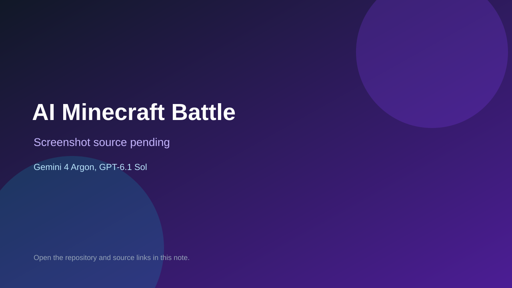

# AI Minecraft Battle

> Verified game note.

## At a glance

- **Score:** 7.5/10
- **Model:** Gemini 4 Argon, GPT-6.1 Sol
- **Technology:** JavaScript, Three.js, Browser
- **Estimated FP32 operations/s at 60 FPS:** 600,000,000 (low confidence; static estimate, not measured).
- **Rating basis:** Estimated from README, source tree and commit history; no runtime playtest.
- **Verified:** 2026-10-15
- **Repository:** [https://github.com/randy-jin/ai-minecraft-battle](https://github.com/randy-jin/ai-minecraft-battle)
- **Evidence:** [creator-reported model evidence](https://github.com/randy-jin/ai-minecraft-battle/blob/main/README.md)
- **Live demo:** [open demo](https://randy-jin.github.io/ai-minecraft-battle/gemini-4-argon.html)
- **Additional live link:** [open demo](https://randy-jin.github.io/ai-minecraft-battle/gpt-6.1-sol.html)

## Screenshots

No screenshot source is recorded yet. Keep the placeholder until a repository, awesome list, or creator source provides an image.

## Model attribution

Open the evidence link above. Evidence grade: **creator-reported model evidence**.

## Source description

One prompt, two single-file Minecraft-style voxel games: a Gemini 4 Argon build and a GPT-6.1-sol build, with the shared prompt and a comparison write-up by @RandyJinAI. Counted once across the two model variants. Live demo returned HTTP 200 (availability only, not a playtest). Source inspected only; no playtest.

### Gameplay source

- [https://github.com/randy-jin/ai-minecraft-battle/blob/main/gemini-4-argon.html](https://github.com/randy-jin/ai-minecraft-battle/blob/main/gemini-4-argon.html)
- [https://github.com/randy-jin/ai-minecraft-battle/blob/main/README.md](https://github.com/randy-jin/ai-minecraft-battle/blob/main/README.md)

## Verification notes

- **Status:** verified_source_and_live_demo
- **Counted units in repository:** 1
- **Units covered by this note:** 1
- **Discovery:** GitHub repository search: exact model phrase, created 2026-10-08..2026-10-15 (UTC partitions); https://github.com/randy-jin/ai-minecraft-battle; https://x.com/RandyJinAI

[Back to the awesome list](../../README.md)
