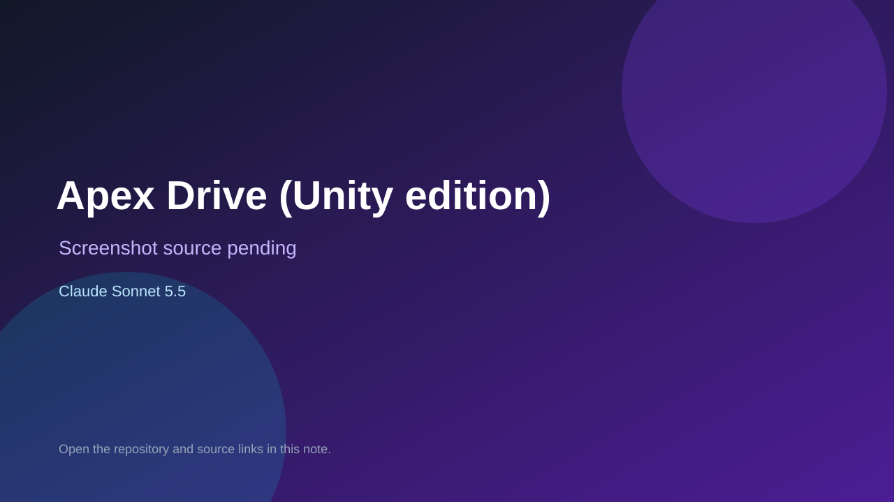

# Apex Drive (Unity edition)

> Verified game note.

## At a glance

- **Score:** 7.6/10
- **Model:** Claude Sonnet 5.5
- **Technology:** C#, Unity, WebGL
- **Estimated FP32 operations/s at 60 FPS:** 800,000,000 (low confidence; static estimate, not measured).
- **Rating basis:** Estimated from README, source tree and commit history; no runtime playtest.
- **Verified:** 2026-10-15
- **Repository:** [https://github.com/kooooneth/apex-drive-unity](https://github.com/kooooneth/apex-drive-unity)
- **Evidence:** [direct model evidence](https://github.com/kooooneth/apex-drive-unity/commit/b4c123defa4575a445393921edd9218432a1599c)
- **Live demo:** [open demo](https://kooooneth.github.io/apex-drive-unity/)

## Screenshots

No screenshot source is recorded yet. Keep the placeholder until a repository, awesome list, or creator source provides an image.

## Model attribution

Open the evidence link above. Evidence grade: **direct model evidence**.

## Source description

Procedural first-person F1 racing game ported from the creator's three.js Apex Drive to Unity, with code-generated tracks, cars, HUD, menu and weather; Claude Sonnet 5.5 trailers. Live demo returned HTTP 200 (availability only, not a playtest). Source inspected only; no playtest.

### Gameplay source

- [https://github.com/kooooneth/apex-drive-unity/blob/main/Assets/Editor/WebGLBuilder.cs](https://github.com/kooooneth/apex-drive-unity/blob/main/Assets/Editor/WebGLBuilder.cs)
- [https://github.com/kooooneth/apex-drive-unity/commit/b4c123defa4575a445393921edd9218432a1599c](https://github.com/kooooneth/apex-drive-unity/commit/b4c123defa4575a445393921edd9218432a1599c)

## Verification notes

- **Status:** verified_source_and_live_demo
- **Counted units in repository:** 1
- **Units covered by this note:** 1
- **Discovery:** GitHub commit pool: model+game commits 2026-10-08..2026-10-15 joined to repositories created after 2026-10-07T17:00Z; https://github.com/kooooneth/apex-drive-unity

[Back to the awesome list](../../README.md)
