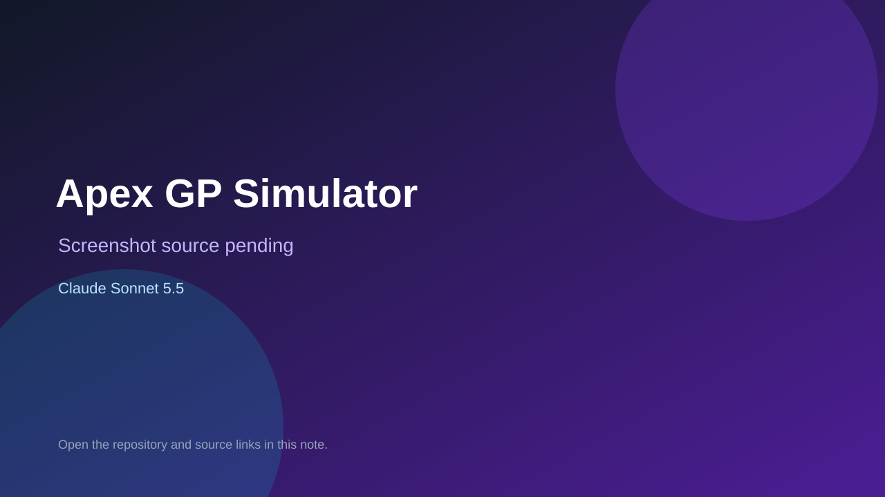

# Apex GP Simulator

> Verified game note.

## At a glance

- **Score:** 7.4/10
- **Model:** Claude Sonnet 5.5
- **Technology:** JavaScript, Three.js, Browser, Capacitor
- **Estimated FP32 operations/s at 60 FPS:** 1,000,000,000 (low confidence; static estimate, not measured).
- **Rating basis:** Heuristic from source size, README and commit history (5.8 + 0.6*log10(code KB+1), +0.3 with a reachable demo); no runtime playtest.
- **Verified:** 2026-10-16
- **Repository:** [https://github.com/MaKyS0/races](https://github.com/MaKyS0/races)
- **Evidence:** [direct model evidence](https://github.com/MaKyS0/races/commit/f0e89306bfc4f8b8b1f5d9306d14a9df5523efc1)

## Screenshots

No screenshot source is recorded yet. Keep the placeholder until a repository, awesome list, or creator source provides an image.

## Model attribution

Open the evidence link above. Evidence grade: **direct model evidence**.

## Source description

Physics-focused 3D Formula-style racing simulator with its own car physics, procedural tracks and race manager, for browser and mobile via Capacitor. Commit carries an exact Claude Sonnet 5.5 co-author trailer. Source inspected only; no playtest.

### Gameplay source

- [https://github.com/MaKyS0/races/blob/claude/kind-planck-rlbfhf/src/race/RaceManager.js](https://github.com/MaKyS0/races/blob/claude/kind-planck-rlbfhf/src/race/RaceManager.js)
- [https://github.com/MaKyS0/races/commit/f0e89306bfc4f8b8b1f5d9306d14a9df5523efc1](https://github.com/MaKyS0/races/commit/f0e89306bfc4f8b8b1f5d9306d14a9df5523efc1)

## Verification notes

- **Status:** verified_source
- **Counted units in repository:** 1
- **Units covered by this note:** 1
- **Discovery:** GitHub commit pool: model+game commits 2026-10-15..2026-10-16 (6-hour UTC partitions) joined to repositories created after 2026-10-14T17:00Z; https://github.com/MaKyS0/races

[Back to the awesome list](../../README.md)
