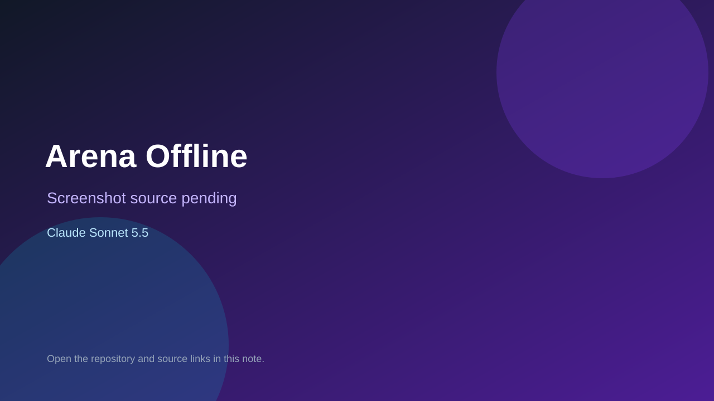

# Arena Offline

> Verified game note.

## At a glance

- **Score:** 7.3/10
- **Model:** Claude Sonnet 5.5
- **Technology:** TypeScript, Browser, WebRTC
- **Estimated FP32 operations/s at 60 FPS:** 100,000,000 (low confidence; static estimate, not measured).
- **Rating basis:** Estimated from README, source tree and commit history; no runtime playtest.
- **Verified:** 2026-10-15
- **Repository:** [https://github.com/guibessa1109-sys/offline-games-with-AI](https://github.com/guibessa1109-sys/offline-games-with-AI)
- **Evidence:** [creator-reported model evidence](https://github.com/guibessa1109-sys/offline-games-with-AI)
- **Live demo:** [open demo](https://offline-games-with-ai.vercel.app)

## Screenshots

No screenshot source is recorded yet. Keep the placeholder until a repository, awesome list, or creator source provides an image.

## Model attribution

Open the evidence link above. Evidence grade: **creator-reported model evidence**.

## Source description

Portuguese offline game hub advertising 60 games (arcade, board vs AI, cards, puzzles, words, reflex) with local and WebRTC two-machine play; source registries in src/*.ts name the games. Counted as one aggregate unit until each mini-game loop is verified. The description says the games were made with Claude Sonnet 5.5; no README or trailer. Live demo returned HTTP 200 (availability only, not a playtest). Source inspected only; no playtest.

### Gameplay source

- [https://github.com/guibessa1109-sys/offline-games-with-AI/blob/main/dist/app.js](https://github.com/guibessa1109-sys/offline-games-with-AI/blob/main/dist/app.js)
- [https://github.com/guibessa1109-sys/offline-games-with-AI](https://github.com/guibessa1109-sys/offline-games-with-AI)

## Verification notes

- **Status:** verified_source_and_live_demo
- **Counted units in repository:** 1
- **Units covered by this note:** 1
- **Discovery:** GitHub repository search: exact model phrase, created 2026-10-08..2026-10-15 (UTC partitions); https://github.com/guibessa1109-sys/offline-games-with-AI

[Back to the awesome list](../../README.md)
