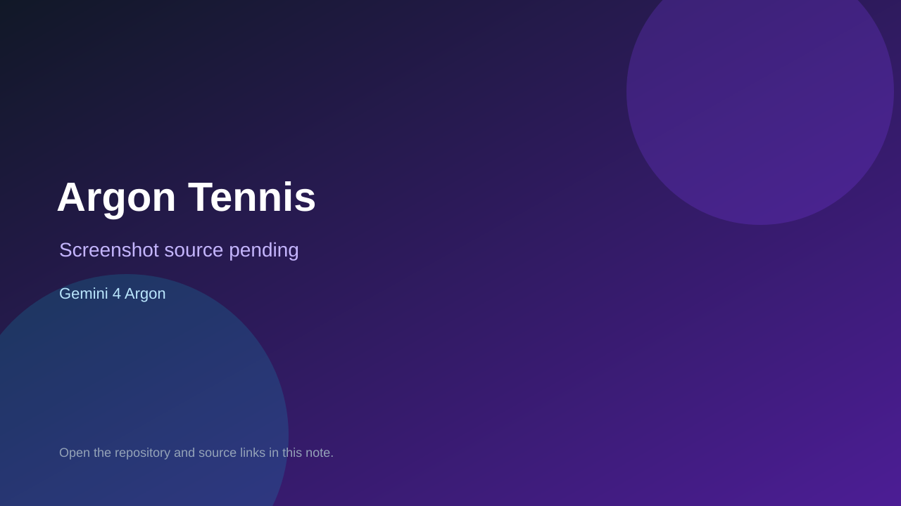

# Argon Tennis

> Verified game note.

## At a glance

- **Score:** 8.2/10
- **Model:** Gemini 4 Argon
- **Technology:** Three.js, WebGL, GLSL, Web Audio API, Browser
- **Estimated FP32 operations/s at 60 FPS:** 500,000,000 (low confidence; static estimate, not measured).
- **Rating basis:** Six scoped playable browser games with documented controls, objectives and progression; no runtime playtest.
- **Verified:** 2026-10-14
- **Repository:** [https://github.com/ammaarreshi/argon-games](https://github.com/ammaarreshi/argon-games)
- **Evidence:** [creator-reported model evidence](https://github.com/ammaarreshi/argon-games/commit/7751fffc4cad78def8fe0bd22c3fe18776caabf3)

## Screenshots

No screenshot source is recorded yet. Keep the placeholder until a repository, awesome list, or creator source provides an image.

## Model attribution

Open the evidence link above. Evidence grade: **creator-reported model evidence**.

## Source description

Repository description states Gemini 4 Argon game showcase. Six folders each contain index.html plus src and assets with per-game READMEs documenting controls, objectives and run paths; root README links each game to ai.studio/build Argon creation. Tennis has gyro/webcam/multiplayer, Airspace has 3 airfields and TCAS, Grand Theft Argon has vehicles and 6-star pursuit, Valley has tools/crafting/villagers, Towers has 100 waves with A* mazing, Corridor has 5 loops and a photo-fragment objective. Source inspected only; no playtest. docs/screenshots holds 6 PNGs (argon-tennis/airspace/towers/valley, grand-theft-argon, the-corridor) left unrated pending screenshot-ratings pass.

### Gameplay source

- [https://github.com/ammaarreshi/argon-games/blob/main/argon-tennis/index.html](https://github.com/ammaarreshi/argon-games/blob/main/argon-tennis/index.html)
- [https://github.com/ammaarreshi/argon-games/commit/7751fffc4cad78def8fe0bd22c3fe18776caabf3](https://github.com/ammaarreshi/argon-games/commit/7751fffc4cad78def8fe0bd22c3fe18776caabf3)

## Verification notes

- **Status:** verified_source
- **Counted units in repository:** 6
- **Units covered by this note:** 1
- **Discovery:** GitHub repository search for gemini-4-argon; https://github.com/ammaarreshi/argon-games

[Back to the awesome list](../../README.md)
