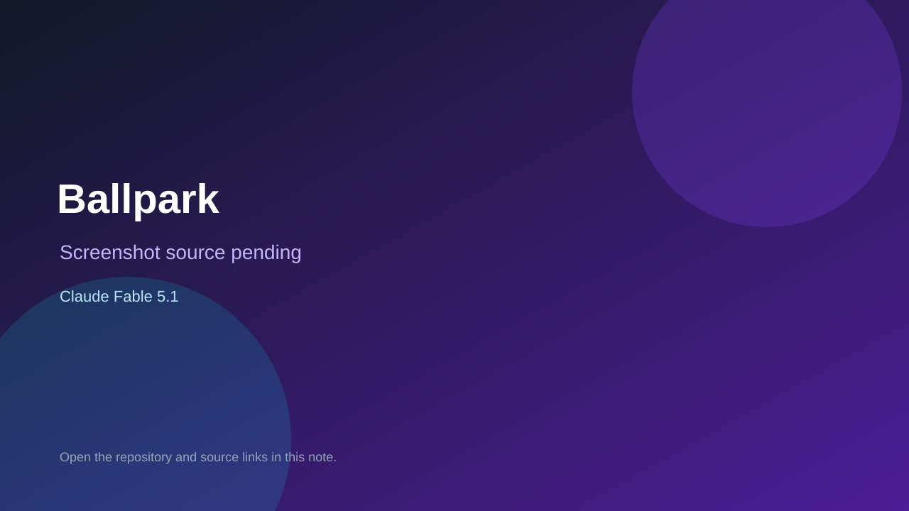

# Ballpark

> Verified game note.

## At a glance

- **Score:** 7.2/10
- **Model:** Claude Fable 5.1
- **Technology:** JavaScript, Browser
- **Estimated FP32 operations/s at 60 FPS:** 10,000,000 (low confidence; static estimate, not measured).
- **Rating basis:** Heuristic from source size, README and commit history (5.8 + 0.6*log10(code KB+1), +0.3 with a reachable demo); no runtime playtest.
- **Verified:** 2026-10-23
- **Repository:** [https://github.com/jameswallace35/Fermi](https://github.com/jameswallace35/Fermi)
- **Evidence:** [direct model evidence](https://github.com/jameswallace35/Fermi/commit/ee7f1480ec1e8087d369326f47c8ee5f86fbde84)

## Screenshots

No screenshot source is recorded yet. Keep the placeholder until a repository, awesome list, or creator source provides an image.

## Model attribution

Open the evidence link above. Evidence grade: **direct model evidence**.

## Source description

Every day the game asks five questions like "How many Hershey's Kisses, side by side, would it take to carpet Greenland?" You get one guess per question, in any order. Your score for a question is how many times off you were: 1× is exact, 2× means you guessed… Commit carries an exact Claude Fable 5.1 co-author trailer. Source inspected from README, file tree and commit history only; no playtest.

### Gameplay source

- [https://github.com/jameswallace35/Fermi/blob/claude/fermi-estimation-game-6fmn3p/src/main.js](https://github.com/jameswallace35/Fermi/blob/claude/fermi-estimation-game-6fmn3p/src/main.js)
- [https://github.com/jameswallace35/Fermi/commit/ee7f1480ec1e8087d369326f47c8ee5f86fbde84](https://github.com/jameswallace35/Fermi/commit/ee7f1480ec1e8087d369326f47c8ee5f86fbde84)

## Verification notes

- **Status:** verified_source
- **Counted units in repository:** 1
- **Units covered by this note:** 1
- **Discovery:** GitHub commit pool: model+game commits 2026-10-21T01:00Z..2026-10-23T01:00Z (20-minute Opus 5.5 and wider other-model UTC partitions) joined to repositories created after 2026-10-20T01:00Z; https://github.com/jameswallace35/Fermi

[Back to the awesome list](../../README.md)
