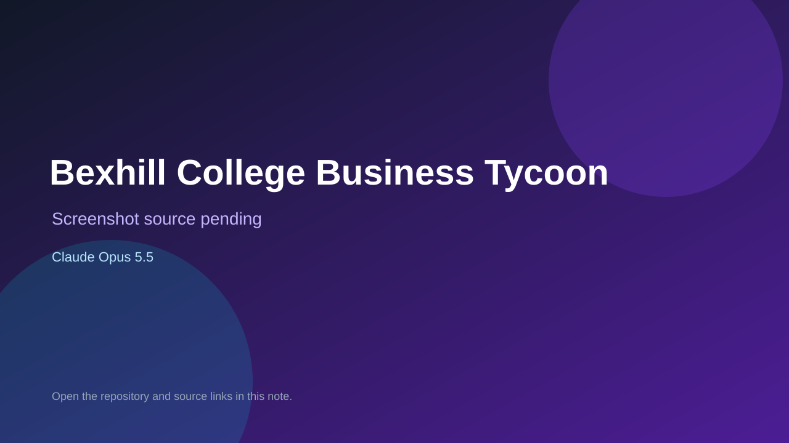

# Bexhill College Business Tycoon

> Verified game note.

## At a glance

- **Score:** 6.9/10
- **Model:** Claude Opus 5.5
- **Technology:** JavaScript, React, Browser
- **Estimated FP32 operations/s at 60 FPS:** 10,000,000 (low confidence; static estimate, not measured).
- **Rating basis:** Heuristic from source size, README and commit history (5.8 + 0.6*log10(code KB+1), +0.3 with a reachable demo); no runtime playtest.
- **Verified:** 2026-10-23
- **Repository:** [https://github.com/tom-landy/OpenEvening2627](https://github.com/tom-landy/OpenEvening2627)
- **Evidence:** [direct model evidence](https://github.com/tom-landy/OpenEvening2627/commit/c175ff75d539c4a7bc457d77c1962bf82441ca2a)

## Screenshots

No screenshot source is recorded yet. Keep the placeholder until a repository, awesome list, or creator source provides an image.

## Model attribution

Open the evidence link above. Evidence grade: **direct model evidence**.

## Source description

An open evening game for Business Studies. Students pick what to sell (12 products), name their business (tap a suggestion or type their own), then make 7 more decisions: location, price, supplier, staff, marketing, ethics, and how to react to a rival (6… Commit carries an exact Claude Opus 5.5 co-author trailer. Source inspected from README, file tree and commit history only; no playtest.

### Gameplay source

- [https://github.com/tom-landy/OpenEvening2627/blob/claude/interactive-business-decisions-t6cehm/public/game.js](https://github.com/tom-landy/OpenEvening2627/blob/claude/interactive-business-decisions-t6cehm/public/game.js)
- [https://github.com/tom-landy/OpenEvening2627/commit/c175ff75d539c4a7bc457d77c1962bf82441ca2a](https://github.com/tom-landy/OpenEvening2627/commit/c175ff75d539c4a7bc457d77c1962bf82441ca2a)

## Verification notes

- **Status:** verified_source
- **Counted units in repository:** 1
- **Units covered by this note:** 1
- **Discovery:** GitHub commit pool: model+game commits 2026-10-21T01:00Z..2026-10-23T01:00Z (20-minute Opus 5.5 and wider other-model UTC partitions) joined to repositories created after 2026-10-20T01:00Z; https://github.com/tom-landy/OpenEvening2627

[Back to the awesome list](../../README.md)
