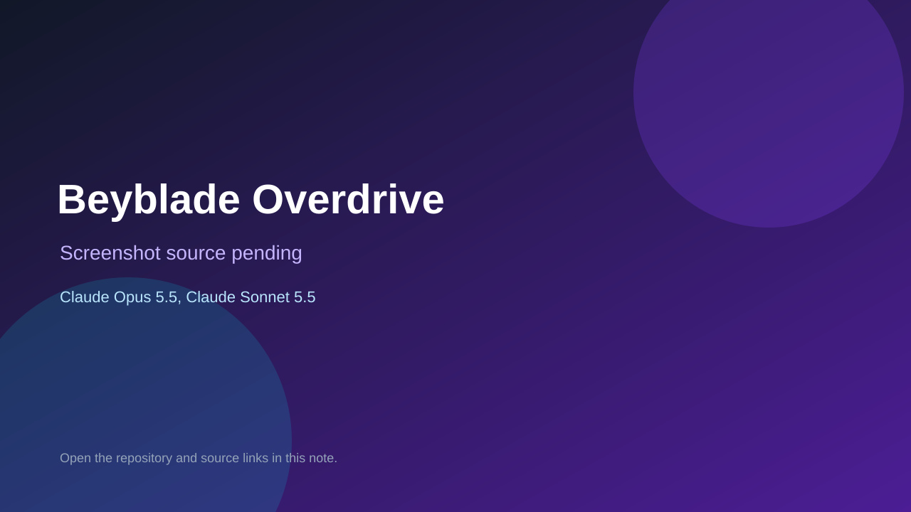

# Beyblade Overdrive

> Verified game note.

## At a glance

- **Score:** 7.1/10
- **Model:** Claude Opus 5.5, Claude Sonnet 5.5
- **Technology:** JavaScript, Three.js, Browser
- **Estimated FP32 operations/s at 60 FPS:** 1,000,000,000 (low confidence; static estimate, not measured).
- **Rating basis:** Heuristic from source size, README and commit history (5.8 + 0.6*log10(code KB+1), +0.3 with a reachable demo); no runtime playtest.
- **Verified:** 2026-10-16
- **Repository:** [https://github.com/choihs-ai/beybladegame](https://github.com/choihs-ai/beybladegame)
- **Evidence:** [direct model evidence](https://github.com/choihs-ai/beybladegame/commit/16c60994548b7c6dd164dbc2f8995ab3d5fca342)

## Screenshots

No screenshot source is recorded yet. Keep the placeholder until a repository, awesome list, or creator source provides an image.

## Model attribution

Open the evidence link above. Evidence grade: **direct model evidence**.

## Source description

Single-file 3D Beyblade battle game with charge dash, impact timing ring, type ultimates and Beyblade X parts. Commit carries an exact Claude Opus 5.5 / Claude Sonnet 5.5 co-author trailer. Source inspected only; no playtest.

### Gameplay source

- [https://github.com/choihs-ai/beybladegame/blob/main/index.html](https://github.com/choihs-ai/beybladegame/blob/main/index.html)
- [https://github.com/choihs-ai/beybladegame/commit/16c60994548b7c6dd164dbc2f8995ab3d5fca342](https://github.com/choihs-ai/beybladegame/commit/16c60994548b7c6dd164dbc2f8995ab3d5fca342)

## Verification notes

- **Status:** verified_source
- **Counted units in repository:** 1
- **Units covered by this note:** 1
- **Discovery:** GitHub commit pool: model+game commits 2026-10-15..2026-10-16 (6-hour UTC partitions) joined to repositories created after 2026-10-14T17:00Z; https://github.com/choihs-ai/beybladegame

[Back to the awesome list](../../README.md)
