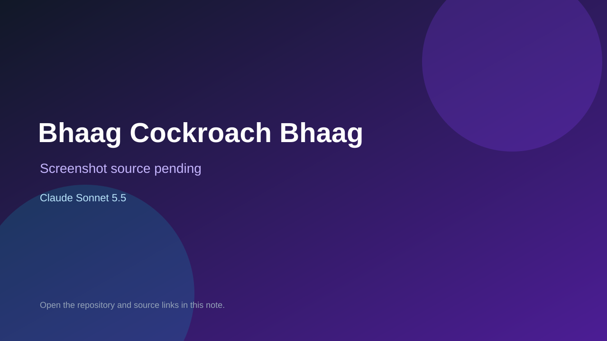

# Bhaag Cockroach Bhaag

> Verified game note.

## At a glance

- **Score:** 7.2/10
- **Model:** Claude Sonnet 5.5
- **Technology:** JavaScript, Three.js, Browser
- **Estimated FP32 operations/s at 60 FPS:** 1,000,000,000 (low confidence; static estimate, not measured).
- **Rating basis:** Heuristic from source size, README and commit history (5.8 + 0.6*log10(code KB+1), +0.3 with a reachable demo); no runtime playtest.
- **Verified:** 2026-10-16
- **Repository:** [https://github.com/cosq-in/bhaag-cockroach-bhaag](https://github.com/cosq-in/bhaag-cockroach-bhaag)
- **Evidence:** [direct model evidence](https://github.com/cosq-in/bhaag-cockroach-bhaag/commit/d1da4a1c7f85b1db3078607fe0881a54802fef37)
- **Live demo:** [open demo](https://bhaag-cockroach-bhaag.vercel.app)

## Screenshots

No screenshot source is recorded yet. Keep the placeholder until a repository, awesome list, or creator source provides an image.

## Model attribution

Open the evidence link above. Evidence grade: **direct model evidence**.

## Source description

Mobile-first 3D satirical endless runner: a cockroach flees a constable, rides bus roofs and collects tokens and power-ups. Commit carries an exact Claude Sonnet 5.5 co-author trailer. Live demo returned HTTP 200 (availability only, not a playtest). Source inspected only; no playtest.

### Gameplay source

- [https://github.com/cosq-in/bhaag-cockroach-bhaag/blob/main/src/world-view.js](https://github.com/cosq-in/bhaag-cockroach-bhaag/blob/main/src/world-view.js)
- [https://github.com/cosq-in/bhaag-cockroach-bhaag/commit/d1da4a1c7f85b1db3078607fe0881a54802fef37](https://github.com/cosq-in/bhaag-cockroach-bhaag/commit/d1da4a1c7f85b1db3078607fe0881a54802fef37)

## Verification notes

- **Status:** verified_source
- **Counted units in repository:** 1
- **Units covered by this note:** 1
- **Discovery:** GitHub commit pool: model+game commits 2026-10-15..2026-10-16 (6-hour UTC partitions) joined to repositories created after 2026-10-14T17:00Z; https://github.com/cosq-in/bhaag-cockroach-bhaag

[Back to the awesome list](../../README.md)
