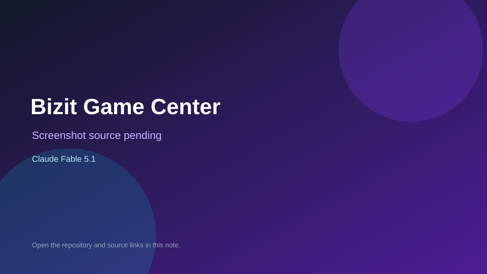

# Bizit Game Center

> Verified game note.

## At a glance

- **Score:** 7.6/10
- **Model:** Claude Fable 5.1
- **Technology:** TypeScript, Browser, Next.js
- **Estimated FP32 operations/s at 60 FPS:** 100,000,000 (low confidence; static estimate, not measured).
- **Rating basis:** Heuristic from source size, README and commit history (5.8 + 0.6*log10(code KB+1), +0.3 with a reachable demo); no runtime playtest.
- **Verified:** 2026-10-16
- **Repository:** [https://github.com/lucassingh/bizit-games](https://github.com/lucassingh/bizit-games)
- **Evidence:** [direct model evidence](https://github.com/lucassingh/bizit-games/commit/c8d328955d8ba8623566633d18732f6fe4d6adf6)
- **Live demo:** [open demo](https://bizit-games.vercel.app)

## Screenshots

No screenshot source is recorded yet. Keep the placeholder until a repository, awesome list, or creator source provides an image.

## Model attribution

Open the evidence link above. Evidence grade: **direct model evidence**.

## Source description

Expo PWA with three mascot games for TVs and tablets (compania, deploy, central) that capture leads. Counted as one aggregate unit. Commit carries an exact Claude Fable 5.1 co-author trailer. Live demo returned HTTP 200 (availability only, not a playtest). Source inspected only; no playtest.

### Gameplay source

- [https://github.com/lucassingh/bizit-games/blob/main/src/games/compania/index.ts](https://github.com/lucassingh/bizit-games/blob/main/src/games/compania/index.ts)
- [https://github.com/lucassingh/bizit-games/commit/c8d328955d8ba8623566633d18732f6fe4d6adf6](https://github.com/lucassingh/bizit-games/commit/c8d328955d8ba8623566633d18732f6fe4d6adf6)

## Verification notes

- **Status:** verified_source
- **Counted units in repository:** 1
- **Units covered by this note:** 1
- **Discovery:** GitHub commit pool: model+game commits 2026-10-15..2026-10-16 (6-hour UTC partitions) joined to repositories created after 2026-10-14T17:00Z; https://github.com/lucassingh/bizit-games

[Back to the awesome list](../../README.md)
