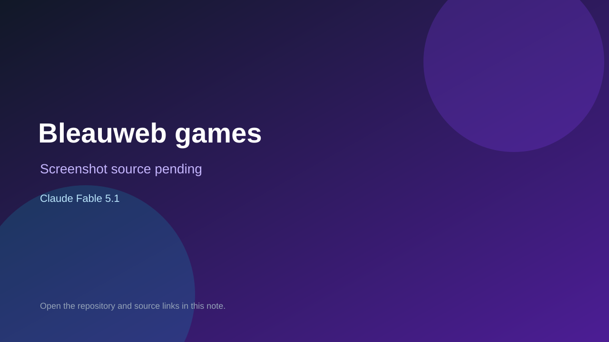

# Bleauweb games

> Verified game note.

## At a glance

- **Score:** 7.3/10
- **Model:** Claude Fable 5.1
- **Technology:** HTML, JavaScript, Canvas, Browser
- **Estimated FP32 operations/s at 60 FPS:** 50,000,000 (low confidence; static estimate, not measured).
- **Rating basis:** Estimated from README, source tree and commit history; no runtime playtest.
- **Verified:** 2026-10-15
- **Repository:** [https://github.com/bleauweb/games.bleauweb.org](https://github.com/bleauweb/games.bleauweb.org)
- **Evidence:** [direct model evidence](https://github.com/bleauweb/games.bleauweb.org/commit/df3730f9c01359ceb4e6ebdd16e4765aa25666d8)

## Screenshots

No screenshot source is recorded yet. Keep the placeholder until a repository, awesome list, or creator source provides an image.

## Model attribution

Open the evidence link above. Evidence grade: **direct model evidence**.

## Source description

Static hub of small browser games (Market Day, Gate Rush lane runner and others); counted as one aggregate unit; Claude Fable 5.1 trailers. Source inspected only; no playtest.

### Gameplay source

- [https://github.com/bleauweb/games.bleauweb.org/blob/main/404.html](https://github.com/bleauweb/games.bleauweb.org/blob/main/404.html)
- [https://github.com/bleauweb/games.bleauweb.org/commit/df3730f9c01359ceb4e6ebdd16e4765aa25666d8](https://github.com/bleauweb/games.bleauweb.org/commit/df3730f9c01359ceb4e6ebdd16e4765aa25666d8)

## Verification notes

- **Status:** verified_source
- **Counted units in repository:** 1
- **Units covered by this note:** 1
- **Discovery:** GitHub commit pool: model+game commits 2026-10-08..2026-10-15 joined to repositories created after 2026-10-07T17:00Z; https://github.com/bleauweb/games.bleauweb.org

[Back to the awesome list](../../README.md)
