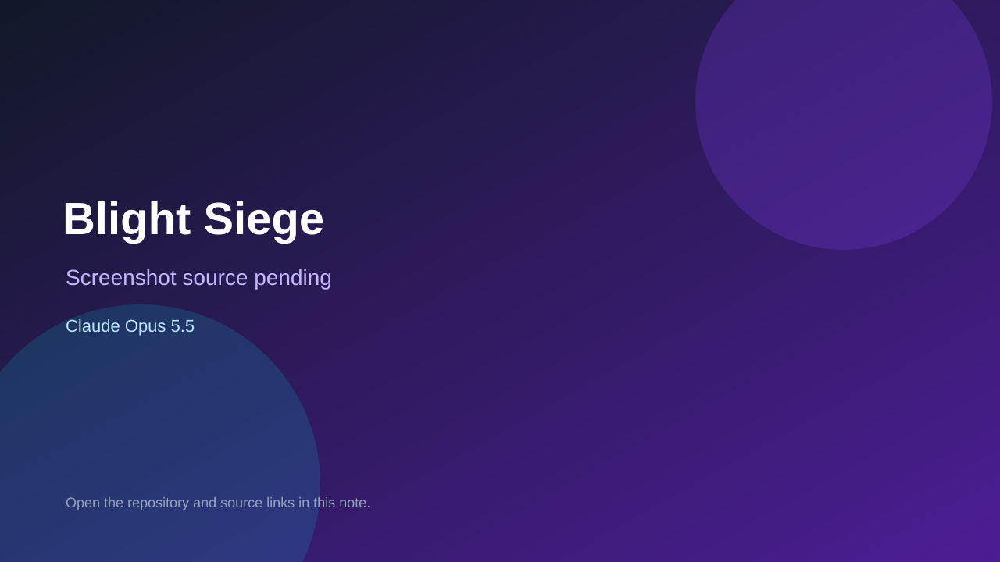

# Blight Siege

> Verified game note.

## At a glance

- **Score:** 7.6/10
- **Model:** Claude Opus 5.5
- **Technology:** HTML, JavaScript, Canvas, Browser
- **Estimated FP32 operations/s at 60 FPS:** 100,000,000 (low confidence; static estimate, not measured).
- **Rating basis:** Heuristic from source size, README and commit history (5.8 + 0.6*log10(code KB+1), +0.3 with a reachable demo); no runtime playtest.
- **Verified:** 2026-10-16
- **Repository:** [https://github.com/Palm-Health-Tech/tamers-gambit-play](https://github.com/Palm-Health-Tech/tamers-gambit-play)
- **Evidence:** [direct model evidence](https://github.com/Palm-Health-Tech/tamers-gambit-play/commit/8c066927f3cf4d495fb0029f57789893b2f586b7)
- **Live demo:** [open demo](https://palm-health-tech.github.io/tamers-gambit-play/)

## Screenshots

No screenshot source is recorded yet. Keep the placeholder until a repository, awesome list, or creator source provides an image.

## Model attribution

Open the evidence link above. Evidence grade: **direct model evidence**.

## Source description

Browser deck-building tower-defense roguelike set in Tamer's Gambit: play creature cards as towers and climb three acts. Commit carries an exact Claude Opus 5.5 co-author trailer. Live demo returned HTTP 200 (availability only, not a playtest). Source inspected only; no playtest.

### Gameplay source

- [https://github.com/Palm-Health-Tech/tamers-gambit-play/blob/main/index.html](https://github.com/Palm-Health-Tech/tamers-gambit-play/blob/main/index.html)
- [https://github.com/Palm-Health-Tech/tamers-gambit-play/commit/8c066927f3cf4d495fb0029f57789893b2f586b7](https://github.com/Palm-Health-Tech/tamers-gambit-play/commit/8c066927f3cf4d495fb0029f57789893b2f586b7)

## Verification notes

- **Status:** verified_source
- **Counted units in repository:** 1
- **Units covered by this note:** 1
- **Discovery:** GitHub commit pool: model+game commits 2026-10-15..2026-10-16 (6-hour UTC partitions) joined to repositories created after 2026-10-14T17:00Z; https://github.com/Palm-Health-Tech/tamers-gambit-play

[Back to the awesome list](../../README.md)
