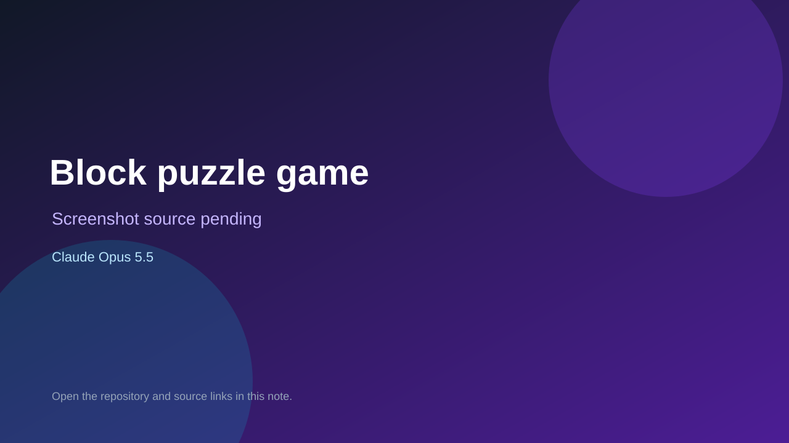

# Block puzzle game

> Verified game note.

## At a glance

- **Score:** 7.4/10
- **Model:** Claude Opus 5.5
- **Technology:** C#
- **Estimated FP32 operations/s at 60 FPS:** 1,000,000 (low confidence; static estimate, not measured).
- **Rating basis:** Heuristic from source size, README and commit history (5.8 + 0.6*log10(code KB+1), +0.3 with a reachable demo); no runtime playtest.
- **Verified:** 2026-10-21
- **Repository:** [https://github.com/RicardoZambon/BlockBlast](https://github.com/RicardoZambon/BlockBlast)
- **Evidence:** [direct model evidence](https://github.com/RicardoZambon/BlockBlast/commit/b3f5a3d3c45d27379f048ed234fedfd3a87faf6c)

## Screenshots

No screenshot source is recorded yet. Keep the placeholder until a repository, awesome list, or creator source provides an image.

## Model attribution

Open the evidence link above. Evidence grade: **direct model evidence**.

## Source description

An original 8×8 block puzzle for iOS and Android (working title). This repository holds the plans, the game's rules engine and the Unity app: Home, a first-time tutorial, Classic with pause and game over, the Daily Puzzle, and Settings. Commit carries an exact Claude Opus 5.5 co-author trailer. Source inspected from README, file tree and commit history only; no playtest.

### Gameplay source

- [https://github.com/RicardoZambon/BlockBlast/blob/main/unity/Assets/Game/Tests/PlayMode/GameFlowTests.cs](https://github.com/RicardoZambon/BlockBlast/blob/main/unity/Assets/Game/Tests/PlayMode/GameFlowTests.cs)
- [https://github.com/RicardoZambon/BlockBlast/commit/b3f5a3d3c45d27379f048ed234fedfd3a87faf6c](https://github.com/RicardoZambon/BlockBlast/commit/b3f5a3d3c45d27379f048ed234fedfd3a87faf6c)

## Verification notes

- **Status:** verified_source
- **Counted units in repository:** 1
- **Units covered by this note:** 1
- **Discovery:** GitHub commit pool: model+game commits 2026-10-17T01:00Z..2026-10-21T01:00Z (1-hour Opus, 3-hour Sonnet, 6-hour other UTC partitions) joined to repositories created after 2026-10-17T00:00Z; https://github.com/RicardoZambon/BlockBlast

[Back to the awesome list](../../README.md)
