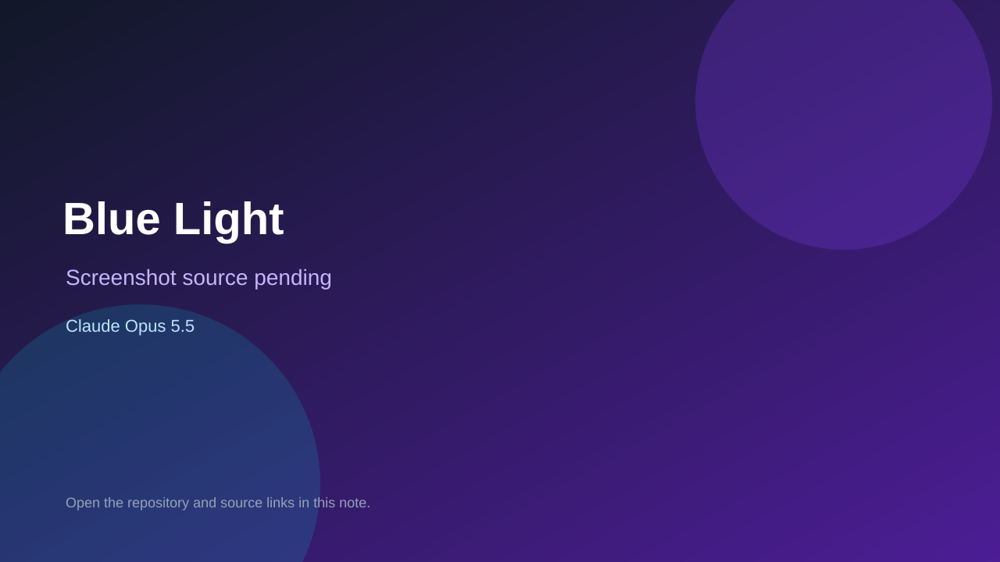

# Blue Light

> Top-list entry: **today** (#2), **this week** (#11), **this month** (#14).

## At a glance

- **Score:** 8.4/10
- **Model:** Claude Opus 5.5
- **Technology:** C#
- **Estimated FP32 operations/s at 60 FPS:** 1,000,000 (low confidence; static estimate, not measured).
- **Rating basis:** Heuristic from source size, README and commit history (5.8 + 0.6*log10(code KB+1), +0.3 with a reachable demo); no runtime playtest.
- **Verified:** 2026-10-23
- **Repository:** [https://github.com/datadrowner/BlueLight](https://github.com/datadrowner/BlueLight)
- **Evidence:** [direct model evidence](https://github.com/datadrowner/BlueLight/commit/977e74ad84a7f3c9648e8840a7fe712ca66b17d7)
- **Live demo:** [open demo](https://projectbluelight.eu)

## Screenshots

No screenshot source is recorded yet. Keep the placeholder until a repository, awesome list, or creator source provides an image.

## Model attribution

Open the evidence link above. Evidence grade: **direct model evidence**.

## Source description

Blue Light: real-time strategy game about emergency services (fire, rescue, police, technical relief) for Windows and Linux. Source-available, alpha. Commit carries an exact Claude Opus 5.5 co-author trailer. Live demo returned HTTP 200 (availability only, not a playtest). Source inspected from README, file tree and commit history only; no playtest.

### Gameplay source

- [https://github.com/datadrowner/BlueLight/blob/main/Core.Tests/DMathReference.cs](https://github.com/datadrowner/BlueLight/blob/main/Core.Tests/DMathReference.cs)
- [https://github.com/datadrowner/BlueLight/commit/977e74ad84a7f3c9648e8840a7fe712ca66b17d7](https://github.com/datadrowner/BlueLight/commit/977e74ad84a7f3c9648e8840a7fe712ca66b17d7)

## Verification notes

- **Status:** verified_source
- **Counted units in repository:** 1
- **Units covered by this note:** 1
- **Discovery:** GitHub commit pool: model+game commits 2026-10-21T01:00Z..2026-10-23T01:00Z (20-minute Opus 5.5 and wider other-model UTC partitions) joined to repositories created after 2026-10-20T01:00Z; https://github.com/datadrowner/BlueLight

[Back to the awesome list](../../README.md)
