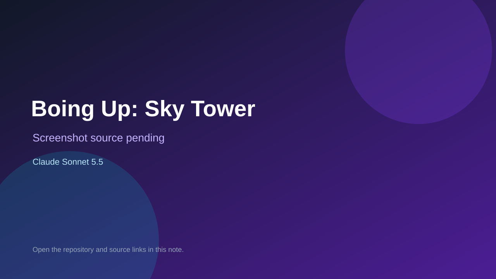

# Boing Up: Sky Tower

> Verified game note.

## At a glance

- **Score:** 7.6/10
- **Model:** Claude Sonnet 5.5
- **Technology:** Unity, C#
- **Estimated FP32 operations/s at 60 FPS:** 1,000,000,000 (low confidence; static estimate, not measured).
- **Rating basis:** Heuristic from source size, README and commit history (5.8 + 0.6*log10(code KB+1), +0.3 with a reachable demo); no runtime playtest.
- **Verified:** 2026-10-21
- **Repository:** [https://github.com/jpdash-creator/boing-up-sky-tower](https://github.com/jpdash-creator/boing-up-sky-tower)
- **Evidence:** [direct model evidence](https://github.com/jpdash-creator/boing-up-sky-tower/commit/8105358ccaf42bcc8f051c31b02c2b775c0f2ceb)

## Screenshots

No screenshot source is recorded yet. Keep the placeholder until a repository, awesome list, or creator source provides an image.

## Model attribution

Open the evidence link above. Evidence grade: **direct model evidence**.

## Source description

A 2D vertical-jumping arcade game for Android and iOS (Unity 6 LTS). Planning docs live in E:\Source\Game Ideas\boing-up-sky-tower\docs\. Commit carries an exact Claude Sonnet 5.5 co-author trailer. Source inspected from README, file tree and commit history only; no playtest.

### Gameplay source

- [https://github.com/jpdash-creator/boing-up-sky-tower/blob/main/Tools/asset_cli/gen_asset_manifest.py](https://github.com/jpdash-creator/boing-up-sky-tower/blob/main/Tools/asset_cli/gen_asset_manifest.py)
- [https://github.com/jpdash-creator/boing-up-sky-tower/commit/8105358ccaf42bcc8f051c31b02c2b775c0f2ceb](https://github.com/jpdash-creator/boing-up-sky-tower/commit/8105358ccaf42bcc8f051c31b02c2b775c0f2ceb)

## Verification notes

- **Status:** verified_source
- **Counted units in repository:** 1
- **Units covered by this note:** 1
- **Discovery:** GitHub commit pool: model+game commits 2026-10-17T01:00Z..2026-10-21T01:00Z (1-hour Opus, 3-hour Sonnet, 6-hour other UTC partitions) joined to repositories created after 2026-10-17T00:00Z; https://github.com/jpdash-creator/boing-up-sky-tower

[Back to the awesome list](../../README.md)
