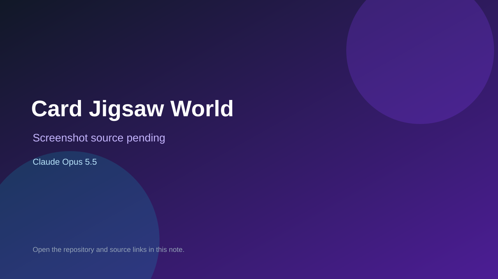

# Card Jigsaw World

> Verified game note.

## At a glance

- **Score:** 7.8/10
- **Model:** Claude Opus 5.5
- **Technology:** Flutter, Dart, Appwrite, Mobile
- **Estimated FP32 operations/s at 60 FPS:** 100,000,000 (low confidence; static estimate, not measured).
- **Rating basis:** Estimated from README, source tree and commit history; no runtime playtest.
- **Verified:** 2026-10-15
- **Repository:** [https://github.com/Meldiron/card-jigsaw-world](https://github.com/Meldiron/card-jigsaw-world)
- **Evidence:** [direct model evidence](https://github.com/Meldiron/card-jigsaw-world/commit/8d5d2032a17edf385d5068b21e74ac959cf5def7)

## Screenshots

No screenshot source is recorded yet. Keep the placeholder until a repository, awesome list, or creator source provides an image.

## Model attribution

Open the evidence link above. Evidence grade: **direct model evidence**.

## Source description

Cozy card-swapping picture puzzle game for iOS and Android (web planned) with an Appwrite backend and CI; Claude Opus 5.5 trailers. Source inspected only; no playtest.

### Gameplay source

- [https://github.com/Meldiron/card-jigsaw-world/blob/main/functions/catalog-snapshot/src/main.js](https://github.com/Meldiron/card-jigsaw-world/blob/main/functions/catalog-snapshot/src/main.js)
- [https://github.com/Meldiron/card-jigsaw-world/commit/8d5d2032a17edf385d5068b21e74ac959cf5def7](https://github.com/Meldiron/card-jigsaw-world/commit/8d5d2032a17edf385d5068b21e74ac959cf5def7)

## Verification notes

- **Status:** verified_source
- **Counted units in repository:** 1
- **Units covered by this note:** 1
- **Discovery:** GitHub commit pool: model+game commits 2026-10-08..2026-10-15 joined to repositories created after 2026-10-07T17:00Z; https://github.com/Meldiron/card-jigsaw-world

[Back to the awesome list](../../README.md)
