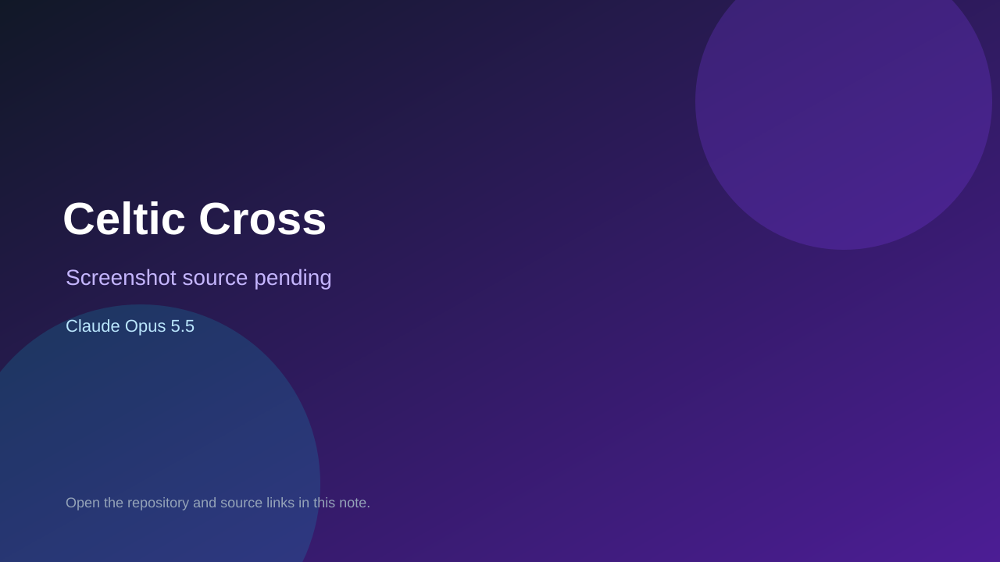

# Celtic Cross

> Verified game note.

## At a glance

- **Score:** 7.3/10
- **Model:** Claude Opus 5.5
- **Technology:** JavaScript, Browser
- **Estimated FP32 operations/s at 60 FPS:** 10,000,000 (low confidence; static estimate, not measured).
- **Rating basis:** Heuristic from source size, README and commit history (5.8 + 0.6*log10(code KB+1), +0.3 with a reachable demo); no runtime playtest.
- **Verified:** 2026-10-17
- **Repository:** [https://github.com/richiewharris/CelticCross](https://github.com/richiewharris/CelticCross)
- **Evidence:** [direct model evidence](https://github.com/richiewharris/CelticCross/commit/a3f89ce9a4e5b9e3c99813c284a0409fa8de1a10)

## Screenshots

No screenshot source is recorded yet. Keep the placeholder until a repository, awesome list, or creator source provides an image.

## Model attribution

Open the evidence link above. Evidence grade: **direct model evidence**.

## Source description

Small browser games with a Celtic theme. None needs installing or building: open index.html for the front page that links them all, or open a game's own index.html. Commit carries an exact Claude Opus 5.5 co-author trailer. Source inspected from README, file tree and commit history only; no playtest.

### Gameplay source

- [https://github.com/richiewharris/CelticCross/blob/main/monsiv/index.html](https://github.com/richiewharris/CelticCross/blob/main/monsiv/index.html)
- [https://github.com/richiewharris/CelticCross/commit/a3f89ce9a4e5b9e3c99813c284a0409fa8de1a10](https://github.com/richiewharris/CelticCross/commit/a3f89ce9a4e5b9e3c99813c284a0409fa8de1a10)

## Verification notes

- **Status:** verified_source
- **Counted units in repository:** 1
- **Units covered by this note:** 1
- **Discovery:** GitHub commit pool: model+game commits 2026-10-16..2026-10-17 (1-hour Opus, 3-hour Sonnet, 6-hour other UTC partitions) joined to repositories created after 2026-10-16T00:00Z; https://github.com/richiewharris/CelticCross

[Back to the awesome list](../../README.md)
