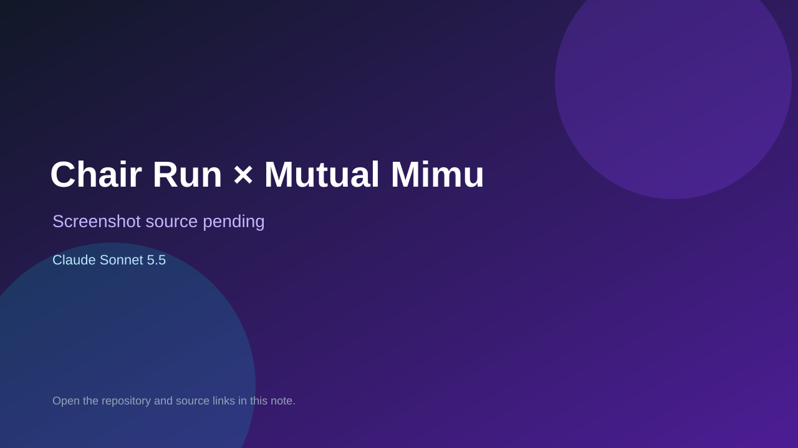

# Chair Run × Mutual Mimu

> Verified game note.

## At a glance

- **Score:** 7.2/10
- **Model:** Claude Sonnet 5.5
- **Technology:** JavaScript, Browser
- **Estimated FP32 operations/s at 60 FPS:** 50,000,000 (low confidence; static estimate, not measured).
- **Rating basis:** Estimated from README, source tree and commit history; no runtime playtest.
- **Verified:** 2026-10-15
- **Repository:** [https://github.com/bertbaccaratt/mimu-mutual-game](https://github.com/bertbaccaratt/mimu-mutual-game)
- **Evidence:** [direct model evidence](https://github.com/bertbaccaratt/mimu-mutual-game/commit/6776782940a95b76aaf1e5fdcf8fd62931667453)

## Screenshots

No screenshot source is recorded yet. Keep the placeholder until a repository, awesome list, or creator source provides an image.

## Model attribution

Open the evidence link above. Evidence grade: **direct model evidence**.

## Source description

Phone-on-a-desk game site for a community giveaway: Chair Run, a pseudo-3D runner, plus a stake-and-vote Mutual Mimu mode, leaderboards and badges; counted once for Chair Run; Claude Sonnet 5.5 trailers. Source inspected only; no playtest.

### Gameplay source

- [https://github.com/bertbaccaratt/mimu-mutual-game/blob/main/404.html](https://github.com/bertbaccaratt/mimu-mutual-game/blob/main/404.html)
- [https://github.com/bertbaccaratt/mimu-mutual-game/commit/6776782940a95b76aaf1e5fdcf8fd62931667453](https://github.com/bertbaccaratt/mimu-mutual-game/commit/6776782940a95b76aaf1e5fdcf8fd62931667453)

## Verification notes

- **Status:** verified_source
- **Counted units in repository:** 1
- **Units covered by this note:** 1
- **Discovery:** GitHub commit pool: model+game commits 2026-10-08..2026-10-15 joined to repositories created after 2026-10-07T17:00Z; https://github.com/bertbaccaratt/mimu-mutual-game

[Back to the awesome list](../../README.md)
