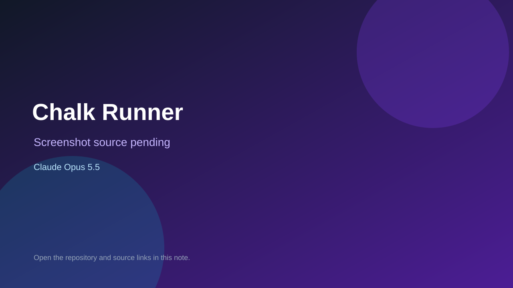

# Chalk Runner

> Verified game note.

## At a glance

- **Score:** 7.0/10
- **Model:** Claude Opus 5.5
- **Technology:** Java
- **Estimated FP32 operations/s at 60 FPS:** 1,000,000 (low confidence; static estimate, not measured).
- **Rating basis:** Heuristic from source size, README and commit history (5.8 + 0.6*log10(code KB+1), +0.3 with a reachable demo); no runtime playtest.
- **Verified:** 2026-10-23
- **Repository:** [https://github.com/saedarm/ChalkRunner](https://github.com/saedarm/ChalkRunner)
- **Evidence:** [direct model evidence](https://github.com/saedarm/ChalkRunner/commit/4999041e8eca2b854988a2dc4130016ae108951d)

## Screenshots

No screenshot source is recorded yet. Keep the placeholder until a repository, awesome list, or creator source provides an image.

## Model attribution

Open the evidence link above. Evidence grade: **direct model evidence**.

## Source description

A stickman runs across a chalkboard on his own. You draw the floor under him with your finger. Lines fade after a few seconds, and there are spikes at the bottom. Built with libGDX for Android (landscape, tuned for the Galaxy S23) with a desktop launcher for… Commit carries an exact Claude Opus 5.5 co-author trailer. Source inspected from README, file tree and commit history only; no playtest.

### Gameplay source

- [https://github.com/saedarm/ChalkRunner/blob/master/core/src/main/java/com/saedarm/chalk/ChalkRunner.java](https://github.com/saedarm/ChalkRunner/blob/master/core/src/main/java/com/saedarm/chalk/ChalkRunner.java)
- [https://github.com/saedarm/ChalkRunner/commit/4999041e8eca2b854988a2dc4130016ae108951d](https://github.com/saedarm/ChalkRunner/commit/4999041e8eca2b854988a2dc4130016ae108951d)

## Verification notes

- **Status:** verified_source
- **Counted units in repository:** 1
- **Units covered by this note:** 1
- **Discovery:** GitHub commit pool: model+game commits 2026-10-21T01:00Z..2026-10-23T01:00Z (20-minute Opus 5.5 and wider other-model UTC partitions) joined to repositories created after 2026-10-20T01:00Z; https://github.com/saedarm/ChalkRunner

[Back to the awesome list](../../README.md)
