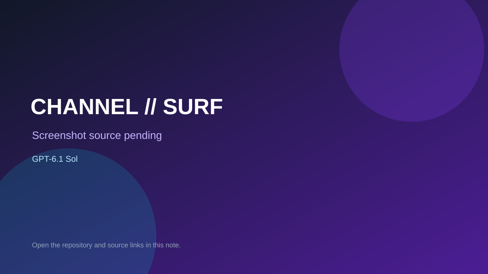

# CHANNEL // SURF

> Verified game note.

## At a glance

- **Score:** 7.6/10
- **Model:** GPT-6.1 Sol
- **Technology:** HTML, JavaScript, Canvas, Browser, Node
- **Estimated FP32 operations/s at 60 FPS:** 100,000,000 (low confidence; static estimate, not measured).
- **Rating basis:** Estimated from README, source tree and commit history; no runtime playtest.
- **Verified:** 2026-10-15
- **Repository:** [https://github.com/steling1/Channel-Surfer](https://github.com/steling1/Channel-Surfer)
- **Evidence:** [creator-reported model evidence](https://github.com/steling1/Channel-Surfer/blob/main/README.md)

## Screenshots

No screenshot source is recorded yet. Keep the placeholder until a repository, awesome list, or creator source provides an image.

## Model attribution

Open the evidence link above. Evidence grade: **creator-reported model evidence**.

## Source description

Dependency-free retro arcade that switches between eight genres (space shooter, runner, breakout, snake, racing, flappy, asteroids, frogger) with touch controls and local/PHP high scores; counted once as one game. The description says GPT 6.1 Sol made it; no trailer. Keep Sol separate from Astra. Source inspected only; no playtest.

### Gameplay source

- [https://github.com/steling1/Channel-Surfer/blob/main/arcade.js](https://github.com/steling1/Channel-Surfer/blob/main/arcade.js)
- [https://github.com/steling1/Channel-Surfer/blob/main/README.md](https://github.com/steling1/Channel-Surfer/blob/main/README.md)

## Verification notes

- **Status:** verified_source
- **Counted units in repository:** 1
- **Units covered by this note:** 1
- **Discovery:** GitHub repository search: exact model phrase, created 2026-10-08..2026-10-15 (UTC partitions); https://github.com/steling1/Channel-Surfer

[Back to the awesome list](../../README.md)
