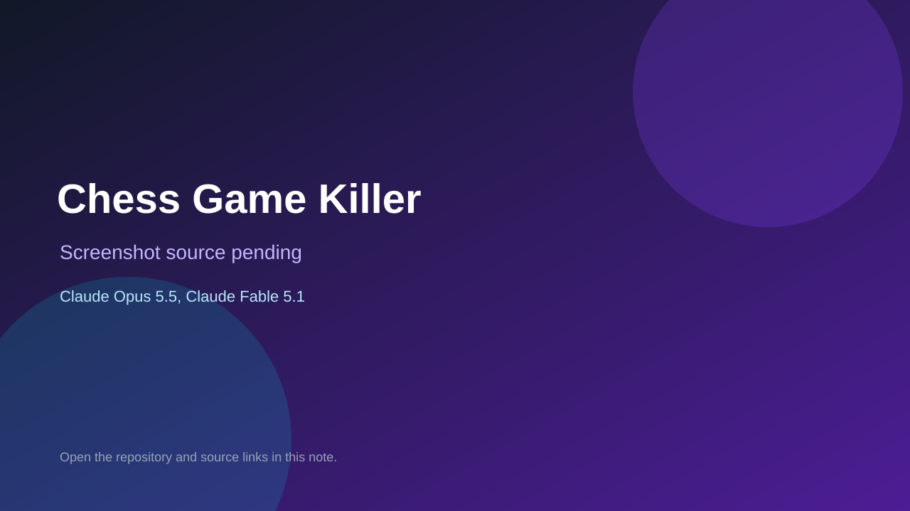

# Chess Game Killer

> Verified game note.

## At a glance

- **Score:** 7.6/10
- **Model:** Claude Opus 5.5, Claude Fable 5.1
- **Technology:** Swift
- **Estimated FP32 operations/s at 60 FPS:** 1,000,000 (low confidence; static estimate, not measured).
- **Rating basis:** Heuristic from source size, README and commit history (5.8 + 0.6*log10(code KB+1), +0.3 with a reachable demo); no runtime playtest.
- **Verified:** 2026-10-21
- **Repository:** [https://github.com/lexdiamondhq-ai/chess-game-killer](https://github.com/lexdiamondhq-ai/chess-game-killer)
- **Evidence:** [direct model evidence](https://github.com/lexdiamondhq-ai/chess-game-killer/commit/9f7f3dd730adcb0685ef64700143143d8a2d5433)

## Screenshots

No screenshot source is recorded yet. Keep the placeholder until a repository, awesome list, or creator source provides an image.

## Model attribution

Open the evidence link above. Evidence grade: **direct model evidence**.

## Source description

One beautiful iOS chess game, with every feature easy to reach and easy to understand. Commit carries an exact Claude Opus 5.5 / Claude Fable 5.1 co-author trailer. Source inspected from README, file tree and commit history only; no playtest.

### Gameplay source

- [https://github.com/lexdiamondhq-ai/chess-game-killer/blob/main/scripts/training/compose_puzzles.py](https://github.com/lexdiamondhq-ai/chess-game-killer/blob/main/scripts/training/compose_puzzles.py)
- [https://github.com/lexdiamondhq-ai/chess-game-killer/commit/9f7f3dd730adcb0685ef64700143143d8a2d5433](https://github.com/lexdiamondhq-ai/chess-game-killer/commit/9f7f3dd730adcb0685ef64700143143d8a2d5433)

## Verification notes

- **Status:** verified_source
- **Counted units in repository:** 1
- **Units covered by this note:** 1
- **Discovery:** GitHub commit pool: model+game commits 2026-10-17T01:00Z..2026-10-21T01:00Z (1-hour Opus, 3-hour Sonnet, 6-hour other UTC partitions) joined to repositories created after 2026-10-17T00:00Z; https://github.com/lexdiamondhq-ai/chess-game-killer

[Back to the awesome list](../../README.md)
