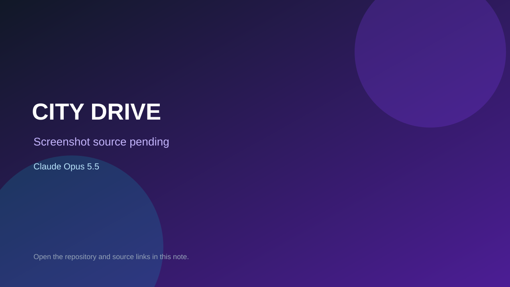

# CITY DRIVE

> Verified game note.

## At a glance

- **Score:** 7.4/10
- **Model:** Claude Opus 5.5
- **Technology:** JavaScript, Three.js, Browser
- **Estimated FP32 operations/s at 60 FPS:** 1,000,000,000 (low confidence; static estimate, not measured).
- **Rating basis:** Heuristic from source size, README and commit history (5.8 + 0.6*log10(code KB+1), +0.3 with a reachable demo); no runtime playtest.
- **Verified:** 2026-10-17
- **Repository:** [https://github.com/isJongmin/DRIVE](https://github.com/isJongmin/DRIVE)
- **Evidence:** [direct model evidence](https://github.com/isJongmin/DRIVE/commit/64c56834cc8aeafb49e220cdb58848fe4d204feb)
- **Live demo:** [open demo](https://isjongmin.github.io/DRIVE/)

## Screenshots

No screenshot source is recorded yet. Keep the placeholder until a repository, awesome list, or creator source provides an image.

## Model attribution

Open the evidence link above. Evidence grade: **direct model evidence**.

## Source description

신호등이 있는 도심과 순환 고속도로를 달리는 웹 3D 드라이빙 게임입니다. 빌드 없이 index.html 하나로 동작합니다(Three.js는 CDN에서 로드). Commit carries an exact Claude Opus 5.5 co-author trailer. Live demo returned HTTP 200 (availability only, not a playtest). Source inspected from README, file tree and commit history only; no playtest.

### Gameplay source

- [https://github.com/isJongmin/DRIVE/blob/main/index.html](https://github.com/isJongmin/DRIVE/blob/main/index.html)
- [https://github.com/isJongmin/DRIVE/commit/64c56834cc8aeafb49e220cdb58848fe4d204feb](https://github.com/isJongmin/DRIVE/commit/64c56834cc8aeafb49e220cdb58848fe4d204feb)

## Verification notes

- **Status:** verified_source
- **Counted units in repository:** 1
- **Units covered by this note:** 1
- **Discovery:** GitHub commit pool: model+game commits 2026-10-16..2026-10-17 (1-hour Opus, 3-hour Sonnet, 6-hour other UTC partitions) joined to repositories created after 2026-10-16T00:00Z; https://github.com/isJongmin/DRIVE

[Back to the awesome list](../../README.md)
