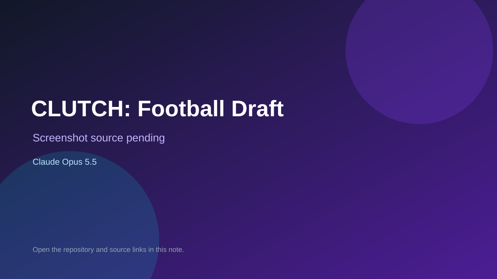

# CLUTCH: Football Draft

> Verified game note.

## At a glance

- **Score:** 7.3/10
- **Model:** Claude Opus 5.5
- **Technology:** JavaScript, Browser
- **Estimated FP32 operations/s at 60 FPS:** 10,000,000 (low confidence; static estimate, not measured).
- **Rating basis:** Heuristic from source size, README and commit history (5.8 + 0.6*log10(code KB+1), +0.3 with a reachable demo); no runtime playtest.
- **Verified:** 2026-10-23
- **Repository:** [https://github.com/shaanElgoat/clutch](https://github.com/shaanElgoat/clutch)
- **Evidence:** [direct model evidence](https://github.com/shaanElgoat/clutch/commit/a1b4236940d216b67c897b65a5900c1f83d3da64)

## Screenshots

No screenshot source is recorded yet. Keep the placeholder until a repository, awesome list, or creator source provides an image.

## Model attribution

Open the evidence link above. Evidence grade: **direct model evidence**.

## Source description

Spin an NFL team, draft from its 2026 roster (new coaches, free agency, trades and the 2026 draft class), and make the call. Legends from the 1990s–2020s and last year's 2025 rosters are only in card packs. A bright, mobile-first PWA. Commit carries an exact Claude Opus 5.5 co-author trailer. Source inspected from README, file tree and commit history only; no playtest.

### Gameplay source

- [https://github.com/shaanElgoat/clutch/blob/main/js/data.js](https://github.com/shaanElgoat/clutch/blob/main/js/data.js)
- [https://github.com/shaanElgoat/clutch/commit/a1b4236940d216b67c897b65a5900c1f83d3da64](https://github.com/shaanElgoat/clutch/commit/a1b4236940d216b67c897b65a5900c1f83d3da64)

## Verification notes

- **Status:** verified_source
- **Counted units in repository:** 1
- **Units covered by this note:** 1
- **Discovery:** GitHub commit pool: model+game commits 2026-10-21T01:00Z..2026-10-23T01:00Z (20-minute Opus 5.5 and wider other-model UTC partitions) joined to repositories created after 2026-10-20T01:00Z; https://github.com/shaanElgoat/clutch

[Back to the awesome list](../../README.md)
