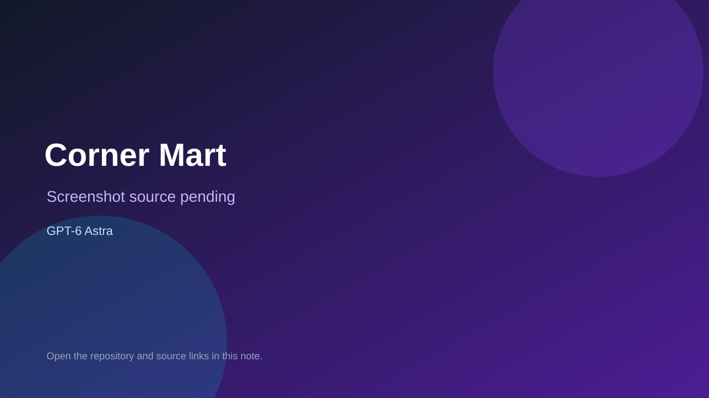

# Corner Mart

> Top-list entry: **today** (#6), **this week** (#8), **this month** (#15).

## At a glance

- **Score:** 8.2/10
- **Model:** GPT-6 Astra
- **Technology:** TypeScript, Three.js, Blender, Browser
- **Estimated FP32 operations/s at 60 FPS:** 800,000,000 (low confidence; static estimate, not measured).
- **Rating basis:** Estimated from README, source tree and commit history; no runtime playtest.
- **Verified:** 2026-10-15
- **Repository:** [https://github.com/ericyanpek/game-sample-corner-mart](https://github.com/ericyanpek/game-sample-corner-mart)
- **Evidence:** [creator-reported model evidence](https://github.com/ericyanpek/game-sample-corner-mart/blob/main/README.md)

## Screenshots

No screenshot source is recorded yet. Keep the placeholder until a repository, awesome list, or creator source provides an image.

## Model attribution

Open the evidence link above. Evidence grade: **creator-reported model evidence**.

## Source description

Three-minute 3D convenience-store management game: plan stock and layout, run a shift with customers and queues, then replay the same traffic. README says GPT-6 Astra wrote the game code and the Blender generator scripts; the single upload commit also carries a Claude Opus 5.5 co-author trailer, recorded here without upgrading it to an authoring claim. Source inspected only; no playtest.

### Gameplay source

- [https://github.com/ericyanpek/game-sample-corner-mart/blob/main/assets/source/build_characters.py](https://github.com/ericyanpek/game-sample-corner-mart/blob/main/assets/source/build_characters.py)
- [https://github.com/ericyanpek/game-sample-corner-mart/blob/main/README.md](https://github.com/ericyanpek/game-sample-corner-mart/blob/main/README.md)

## Verification notes

- **Status:** verified_source
- **Counted units in repository:** 1
- **Units covered by this note:** 1
- **Discovery:** GitHub repository search: exact model phrase, created 2026-10-08..2026-10-15 (UTC partitions); https://github.com/ericyanpek/game-sample-corner-mart

[Back to the awesome list](../../README.md)
