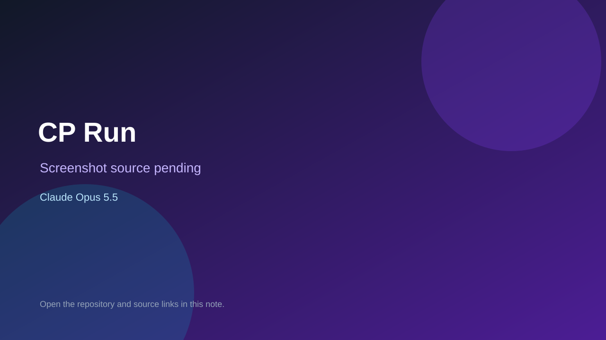

# CP Run

> Verified game note.

## At a glance

- **Score:** 7.2/10
- **Model:** Claude Opus 5.5
- **Technology:** Java, React
- **Estimated FP32 operations/s at 60 FPS:** 10,000,000 (low confidence; static estimate, not measured).
- **Rating basis:** Heuristic from source size, README and commit history (5.8 + 0.6*log10(code KB+1), +0.3 with a reachable demo); no runtime playtest.
- **Verified:** 2026-10-23
- **Repository:** [https://github.com/KeemaKornToTo/ProgmethProject](https://github.com/KeemaKornToTo/ProgmethProject)
- **Evidence:** [direct model evidence](https://github.com/KeemaKornToTo/ProgmethProject/commit/07b32c4dd5a3db4bae88969e6a2fc9acb0bb223a)

## Screenshots

No screenshot source is recorded yet. Keep the placeholder until a repository, awesome list, or creator source provides an image.

## Model attribution

Open the evidence link above. Evidence grade: **direct model evidence**.

## Source description

A 2D endless runner built in Java with JavaFX, inspired by Cookie Run. Pick a cookie, pick a world, then jump and slide past obstacles while collecting jellies, coins and health items. The longer you survive, the faster the world scrolls. Commit carries an exact Claude Opus 5.5 co-author trailer. Source inspected from README, file tree and commit history only; no playtest.

### Gameplay source

- [https://github.com/KeemaKornToTo/ProgmethProject/blob/main/src/main/java/game/managers/CookieManager.java](https://github.com/KeemaKornToTo/ProgmethProject/blob/main/src/main/java/game/managers/CookieManager.java)
- [https://github.com/KeemaKornToTo/ProgmethProject/commit/07b32c4dd5a3db4bae88969e6a2fc9acb0bb223a](https://github.com/KeemaKornToTo/ProgmethProject/commit/07b32c4dd5a3db4bae88969e6a2fc9acb0bb223a)

## Verification notes

- **Status:** verified_source
- **Counted units in repository:** 1
- **Units covered by this note:** 1
- **Discovery:** GitHub commit pool: model+game commits 2026-10-21T01:00Z..2026-10-23T01:00Z (20-minute Opus 5.5 and wider other-model UTC partitions) joined to repositories created after 2026-10-20T01:00Z; https://github.com/KeemaKornToTo/ProgmethProject

[Back to the awesome list](../../README.md)
