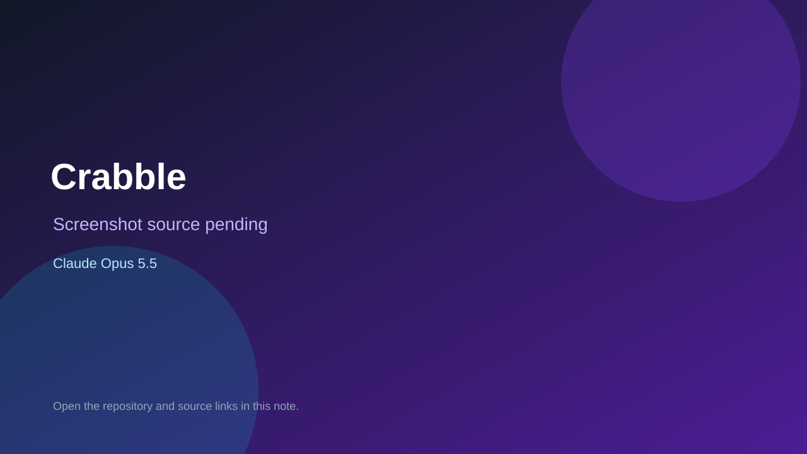

# Crabble

> Verified game note.

## At a glance

- **Score:** 7.6/10
- **Model:** Claude Opus 5.5
- **Technology:** Rust
- **Estimated FP32 operations/s at 60 FPS:** 1,000,000,000 (low confidence; static estimate, not measured).
- **Rating basis:** Heuristic from source size, README and commit history (5.8 + 0.6*log10(code KB+1), +0.3 with a reachable demo); no runtime playtest.
- **Verified:** 2026-10-21
- **Repository:** [https://github.com/ptonkle/crabble](https://github.com/ptonkle/crabble)
- **Evidence:** [direct model evidence](https://github.com/ptonkle/crabble/commit/1ec430ff332c3365e68e32c11877bf5647502ad3)

## Screenshots

No screenshot source is recorded yet. Keep the placeholder until a repository, awesome list, or creator source provides an image.

## Model attribution

Open the evidence link above. Evidence grade: **direct model evidence**.

## Source description

A speed word game played by crabs on the seafloor, in 3D in the browser. Steer your crab round the board, pull letter tiles out of messy piles with your claws, and place them as fast as you can: there are no turns. The last crab to add a letter to a word owns… Commit carries an exact Claude Opus 5.5 co-author trailer. Source inspected from README, file tree and commit history only; no playtest.

### Gameplay source

- [https://github.com/ptonkle/crabble/blob/main/crates/core/src/online/session.rs](https://github.com/ptonkle/crabble/blob/main/crates/core/src/online/session.rs)
- [https://github.com/ptonkle/crabble/commit/1ec430ff332c3365e68e32c11877bf5647502ad3](https://github.com/ptonkle/crabble/commit/1ec430ff332c3365e68e32c11877bf5647502ad3)

## Verification notes

- **Status:** verified_source
- **Counted units in repository:** 1
- **Units covered by this note:** 1
- **Discovery:** GitHub commit pool: model+game commits 2026-10-17T01:00Z..2026-10-21T01:00Z (1-hour Opus, 3-hour Sonnet, 6-hour other UTC partitions) joined to repositories created after 2026-10-17T00:00Z; https://github.com/ptonkle/crabble

[Back to the awesome list](../../README.md)
