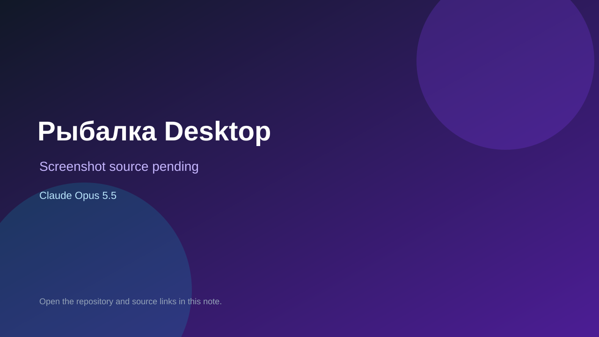

# Рыбалка Desktop

> Verified game note.

## At a glance

- **Score:** 7.3/10
- **Model:** Claude Opus 5.5
- **Technology:** Rust, PixiJS, React, Browser
- **Estimated FP32 operations/s at 60 FPS:** 100,000,000 (low confidence; static estimate, not measured).
- **Rating basis:** Heuristic from source size, README and commit history (5.8 + 0.6*log10(code KB+1), +0.3 with a reachable demo); no runtime playtest.
- **Verified:** 2026-10-17
- **Repository:** [https://github.com/PeacexF/Rybalka-Desktop](https://github.com/PeacexF/Rybalka-Desktop)
- **Evidence:** [direct model evidence](https://github.com/PeacexF/Rybalka-Desktop/commit/9c22edadaa664ef00c49809a263997d82961e8f7)

## Screenshots

No screenshot source is recorded yet. Keep the placeholder until a repository, awesome list, or creator source provides an image.

## Model attribution

Open the evidence link above. Evidence grade: **direct model evidence**.

## Source description

Fan-made offline remake of Russian Fishing 2/3 (Русская Рыбалка) — 2D fishing sim built with Rust, Tauri 2, React and PixiJS. Commit carries an exact Claude Opus 5.5 co-author trailer. Source inspected from README, file tree and commit history only; no playtest.

### Gameplay source

- [https://github.com/PeacexF/Rybalka-Desktop/blob/main/crates/core/src/sim/mod.rs](https://github.com/PeacexF/Rybalka-Desktop/blob/main/crates/core/src/sim/mod.rs)
- [https://github.com/PeacexF/Rybalka-Desktop/commit/9c22edadaa664ef00c49809a263997d82961e8f7](https://github.com/PeacexF/Rybalka-Desktop/commit/9c22edadaa664ef00c49809a263997d82961e8f7)

## Verification notes

- **Status:** verified_source
- **Counted units in repository:** 1
- **Units covered by this note:** 1
- **Discovery:** GitHub commit pool: model+game commits 2026-10-16..2026-10-17 (1-hour Opus, 3-hour Sonnet, 6-hour other UTC partitions) joined to repositories created after 2026-10-16T00:00Z; https://github.com/PeacexF/Rybalka-Desktop

[Back to the awesome list](../../README.md)
