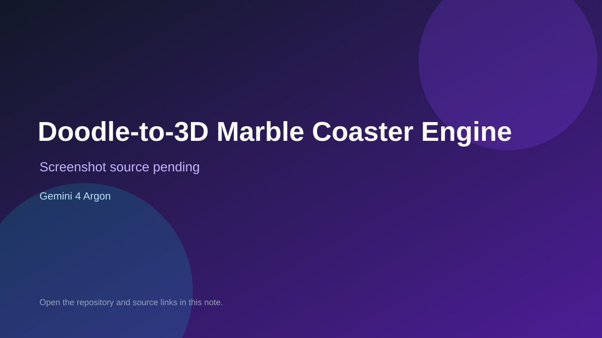

# Doodle-to-3D Marble Coaster Engine

> Verified game note.

## At a glance

- **Score:** 7.8/10
- **Model:** Gemini 4 Argon
- **Technology:** TypeScript, Three.js, Web Audio API, Browser
- **Estimated FP32 operations/s at 60 FPS:** 400,000,000 (low confidence; static estimate, not measured).
- **Rating basis:** Playable coaster builder plus marble races with documented controls and cameras; no runtime playtest.
- **Verified:** 2026-10-14
- **Repository:** [https://github.com/Aqsa-K/doodle-to-3d-marble-coaster](https://github.com/Aqsa-K/doodle-to-3d-marble-coaster)
- **Evidence:** [direct model evidence](https://github.com/Aqsa-K/doodle-to-3d-marble-coaster/commit/5e7fe9e1575f9c2b1a312869ccf41f60ea4a67f7)

## Screenshots

No screenshot source is recorded yet. Keep the placeholder until a repository, awesome list, or creator source provides an image.

## Model attribution

Open the evidence link above. Evidence grade: **direct model evidence**.

## Source description

README header states Built with Gemini 4 Argon and the initial commit message repeats it. Sketch-to-coaster builder converts 2D strokes into banked 3D tracks with loops/overpasses, multi-marble swarm races, 4 cameras and procedural audio; Space/R/1-4 controls documented. src/main.ts, splineEngine.ts, renderer3D.ts, audio.ts present. Source inspected only; no playtest.

### Gameplay source

- [https://github.com/Aqsa-K/doodle-to-3d-marble-coaster/blob/main/index.html](https://github.com/Aqsa-K/doodle-to-3d-marble-coaster/blob/main/index.html)
- [https://github.com/Aqsa-K/doodle-to-3d-marble-coaster/commit/5e7fe9e1575f9c2b1a312869ccf41f60ea4a67f7](https://github.com/Aqsa-K/doodle-to-3d-marble-coaster/commit/5e7fe9e1575f9c2b1a312869ccf41f60ea4a67f7)

## Verification notes

- **Status:** verified_source
- **Counted units in repository:** 1
- **Units covered by this note:** 1
- **Discovery:** GitHub repository search for Built with Gemini 4; https://github.com/Aqsa-K/doodle-to-3d-marble-coaster

[Back to the awesome list](../../README.md)
