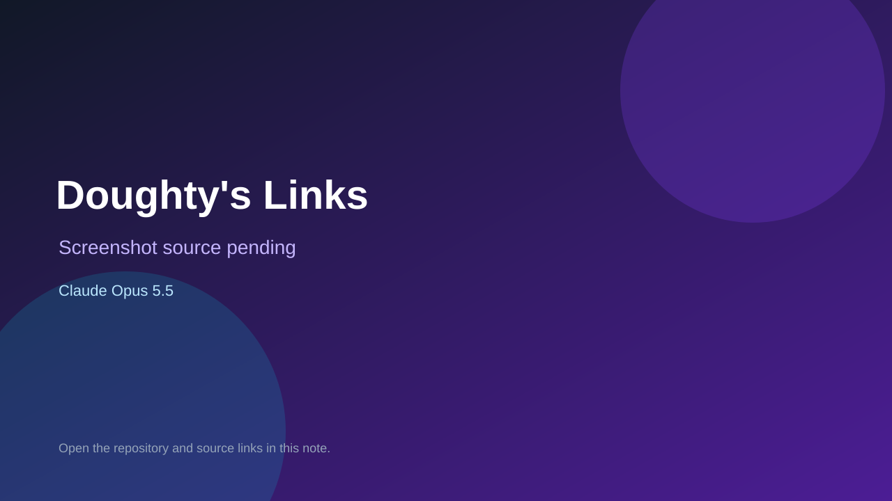

# Doughty's Links

> Verified game note.

## At a glance

- **Score:** 7.6/10
- **Model:** Claude Opus 5.5
- **Technology:** JavaScript, Browser
- **Estimated FP32 operations/s at 60 FPS:** 1,000,000,000 (low confidence; static estimate, not measured).
- **Rating basis:** Heuristic from source size, README and commit history (5.8 + 0.6*log10(code KB+1), +0.3 with a reachable demo); no runtime playtest.
- **Verified:** 2026-10-17
- **Repository:** [https://github.com/delooze29-stack/Doughty-Links](https://github.com/delooze29-stack/Doughty-Links)
- **Evidence:** [direct model evidence](https://github.com/delooze29-stack/Doughty-Links/commit/5deca240a3c55bb365f927ade12c81d903384666)
- **Live demo:** [open demo](https://delooze29-stack.github.io/Doughty-Links/)

## Screenshots

No screenshot source is recorded yet. Keep the placeholder until a repository, awesome list, or creator source provides an image.

## Model attribution

Open the evidence link above. Evidence grade: **direct model evidence**.

## Source description

A 3D golf game in your browser: four courses (Kingfisher Links, The Master Course, Heather Ridge, Little Wren pitch and putt), practice holes, a driving range, replays, a golf buggy, weather and an online leaderboard. Commit carries an exact Claude Opus 5.5 co-author trailer. Live demo returned HTTP 200 (availability only, not a playtest). Source inspected from README, file tree and commit history only; no playtest.

### Gameplay source

- [https://github.com/delooze29-stack/Doughty-Links/blob/main/index.html](https://github.com/delooze29-stack/Doughty-Links/blob/main/index.html)
- [https://github.com/delooze29-stack/Doughty-Links/commit/5deca240a3c55bb365f927ade12c81d903384666](https://github.com/delooze29-stack/Doughty-Links/commit/5deca240a3c55bb365f927ade12c81d903384666)

## Verification notes

- **Status:** verified_source
- **Counted units in repository:** 1
- **Units covered by this note:** 1
- **Discovery:** GitHub commit pool: model+game commits 2026-10-16..2026-10-17 (1-hour Opus, 3-hour Sonnet, 6-hour other UTC partitions) joined to repositories created after 2026-10-16T00:00Z; https://github.com/delooze29-stack/Doughty-Links

[Back to the awesome list](../../README.md)
