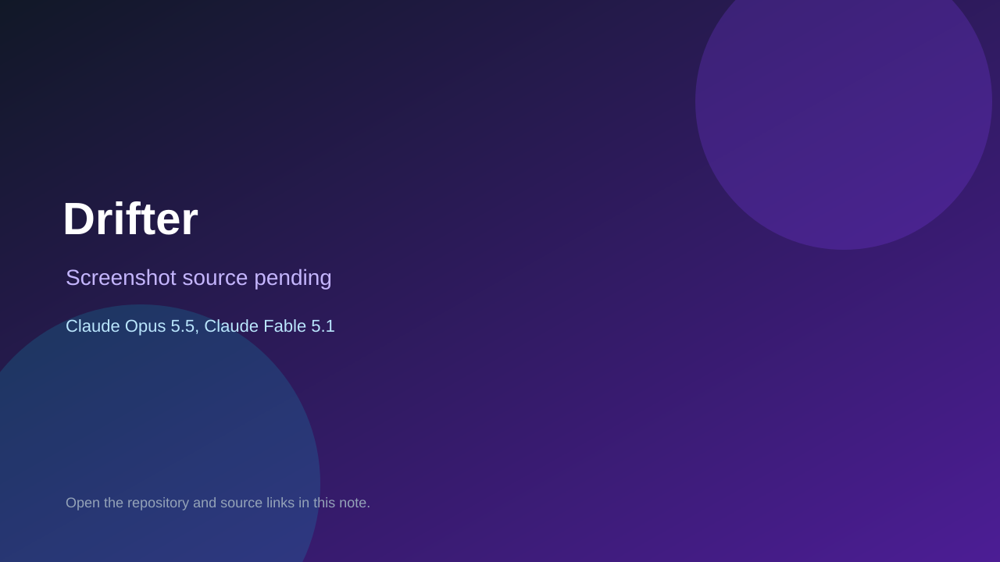

# Drifter

> Verified game note.

## At a glance

- **Score:** 7.6/10
- **Model:** Claude Opus 5.5, Claude Fable 5.1
- **Technology:** TypeScript, React, Browser
- **Estimated FP32 operations/s at 60 FPS:** 10,000,000 (low confidence; static estimate, not measured).
- **Rating basis:** Heuristic from source size, README and commit history (5.8 + 0.6*log10(code KB+1), +0.3 with a reachable demo); no runtime playtest.
- **Verified:** 2026-10-21
- **Repository:** [https://github.com/louisamurray/drifter](https://github.com/louisamurray/drifter)
- **Evidence:** [direct model evidence](https://github.com/louisamurray/drifter/commit/74c3fc0c2369bdf4ab88ce4d02a7d24280eed541)
- **Live demo:** [open demo](https://louisamurray.github.io/drifter/)

## Screenshots

No screenshot source is recorded yet. Keep the placeholder until a repository, awesome list, or creator source provides an image.

## Model attribution

Open the evidence link above. Evidence grade: **direct model evidence**.

## Source description

A simple car-drifting game for mobile browsers. Top-down, portrait, sixty-second runs. Steer with one thumb, or steer with one thumb and drive with the other, and chain drifts for score before the timer runs out. Drive the circuit, or free drift on an open… Commit carries an exact Claude Opus 5.5 / Claude Fable 5.1 co-author trailer. Live demo returned HTTP 200 (availability only, not a playtest). Source inspected from README, file tree and commit history only; no playtest.

### Gameplay source

- [https://github.com/louisamurray/drifter/blob/main/src/render/hud.ts](https://github.com/louisamurray/drifter/blob/main/src/render/hud.ts)
- [https://github.com/louisamurray/drifter/commit/74c3fc0c2369bdf4ab88ce4d02a7d24280eed541](https://github.com/louisamurray/drifter/commit/74c3fc0c2369bdf4ab88ce4d02a7d24280eed541)

## Verification notes

- **Status:** verified_source
- **Counted units in repository:** 1
- **Units covered by this note:** 1
- **Discovery:** GitHub commit pool: model+game commits 2026-10-17T01:00Z..2026-10-21T01:00Z (1-hour Opus, 3-hour Sonnet, 6-hour other UTC partitions) joined to repositories created after 2026-10-17T00:00Z; https://github.com/louisamurray/drifter

[Back to the awesome list](../../README.md)
