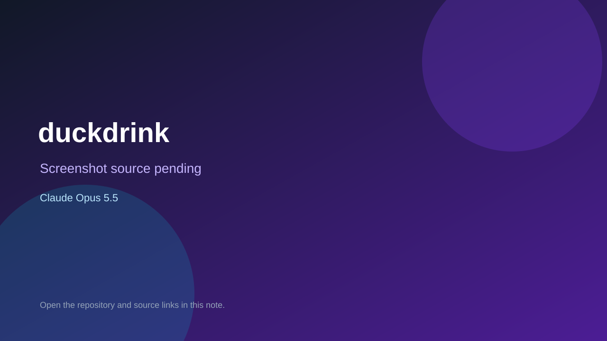

# duckdrink

> Verified game note.

## At a glance

- **Score:** 7.0/10
- **Model:** Claude Opus 5.5
- **Technology:** JavaScript, Browser
- **Estimated FP32 operations/s at 60 FPS:** 50,000,000 (low confidence; static estimate, not measured).
- **Rating basis:** Estimated from README, source tree and commit history; no runtime playtest.
- **Verified:** 2026-10-15
- **Repository:** [https://github.com/oacdlr/duckdrink](https://github.com/oacdlr/duckdrink)
- **Evidence:** [direct model evidence](https://github.com/oacdlr/duckdrink/commit/a24835bd5e80e850b9def2f1ac36ac0ea035d711)
- **Live demo:** [open demo](https://duckdrink.vercel.app)

## Screenshots

No screenshot source is recorded yet. Keep the placeholder until a repository, awesome list, or creator source provides an image.

## Model attribution

Open the evidence link above. Evidence grade: **direct model evidence**.

## Source description

Quick casual game where a duck finds water and pills; commit co-authors Claude Opus 5.5. Live demo returned HTTP 200 (availability only, not a playtest). Source inspected only; no playtest.

### Gameplay source

- [https://github.com/oacdlr/duckdrink/blob/main/index.html](https://github.com/oacdlr/duckdrink/blob/main/index.html)
- [https://github.com/oacdlr/duckdrink/commit/a24835bd5e80e850b9def2f1ac36ac0ea035d711](https://github.com/oacdlr/duckdrink/commit/a24835bd5e80e850b9def2f1ac36ac0ea035d711)

## Verification notes

- **Status:** verified_source_and_live_demo
- **Counted units in repository:** 1
- **Units covered by this note:** 1
- **Discovery:** GitHub commit pool: model+game commits 2026-10-08..2026-10-15 joined to repositories created after 2026-10-07T17:00Z; https://github.com/oacdlr/duckdrink

[Back to the awesome list](../../README.md)
