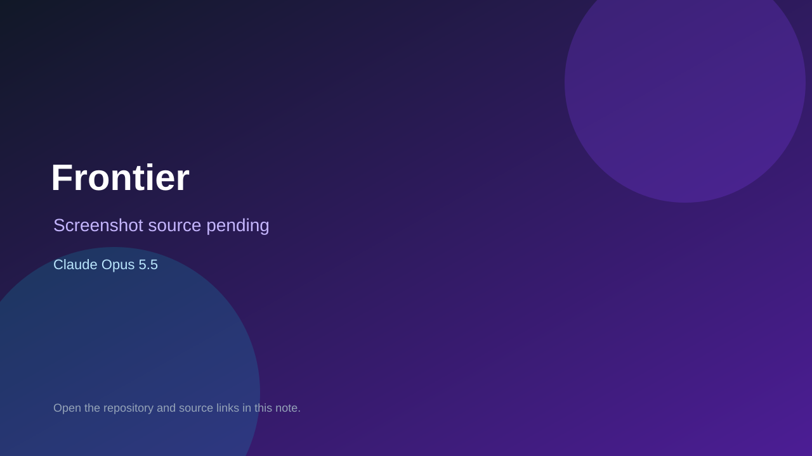

# Frontier

> Top-list entry: **today** (#5).

## At a glance

- **Score:** 7.8/10
- **Model:** Claude Opus 5.5
- **Technology:** HTML, JavaScript, Canvas, Browser
- **Estimated FP32 operations/s at 60 FPS:** 10,000,000 (low confidence; static estimate, not measured).
- **Rating basis:** Heuristic from source size, README and commit history (5.8 + 0.6*log10(code KB+1), +0.3 with a reachable demo); no runtime playtest.
- **Verified:** 2026-10-16
- **Repository:** [https://github.com/g8r-b8/frontierLab](https://github.com/g8r-b8/frontierLab)
- **Evidence:** [direct model evidence](https://github.com/g8r-b8/frontierLab/commit/917e4646a656180c4ea7cfc3f376279572886cde)
- **Live demo:** [open demo](https://g8r-b8.github.io/frontierLab/)

## Screenshots

No screenshot source is recorded yet. Keep the placeholder until a repository, awesome list, or creator source provides an image.

## Model attribution

Open the evidence link above. Evidence grade: **direct model evidence**.

## Source description

Democracy-style management sim about founding a frontier AI lab: policy sliders, lagged cause and effect, stakeholder groups, situations and dilemmas in js/engine.js and js/data. Commit carries an exact Claude Opus 5.5 co-author trailer. Live demo returned HTTP 200 (availability only, not a playtest). Source inspected only; no playtest.

### Gameplay source

- [https://github.com/g8r-b8/frontierLab/blob/main/js/data/archive.js](https://github.com/g8r-b8/frontierLab/blob/main/js/data/archive.js)
- [https://github.com/g8r-b8/frontierLab/commit/917e4646a656180c4ea7cfc3f376279572886cde](https://github.com/g8r-b8/frontierLab/commit/917e4646a656180c4ea7cfc3f376279572886cde)

## Verification notes

- **Status:** verified_source
- **Counted units in repository:** 1
- **Units covered by this note:** 1
- **Discovery:** GitHub commit pool: model+game commits 2026-10-15..2026-10-16 (6-hour UTC partitions) joined to repositories created after 2026-10-14T17:00Z; https://github.com/g8r-b8/frontierLab

[Back to the awesome list](../../README.md)
