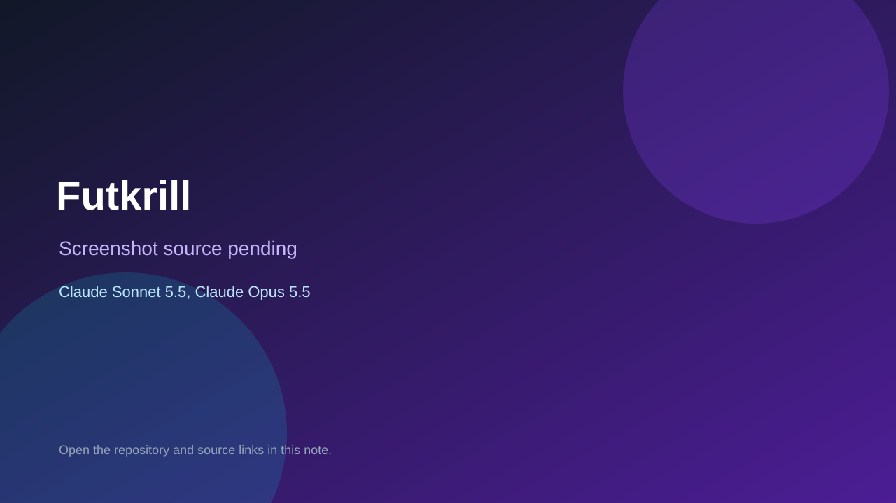

# Futkrill

> Verified game note.

## At a glance

- **Score:** 7.3/10
- **Model:** Claude Sonnet 5.5, Claude Opus 5.5
- **Technology:** Python, Next.js, Browser
- **Estimated FP32 operations/s at 60 FPS:** 50,000,000 (low confidence; static estimate, not measured).
- **Rating basis:** Estimated from README, source tree and commit history; no runtime playtest.
- **Verified:** 2026-10-15
- **Repository:** [https://github.com/emrekapancibuilds/futbol-krillion](https://github.com/emrekapancibuilds/futbol-krillion)
- **Evidence:** [direct model evidence](https://github.com/emrekapancibuilds/futbol-krillion/commit/a59dc53adfc13db1e13435ef9ce192409f68d6fe)

## Screenshots

No screenshot source is recorded yet. Keep the placeholder until a repository, awesome list, or creator source provides an image.

## Model attribution

Open the evidence link above. Evidence grade: **direct model evidence**.

## Source description

Football trivia game with a shared daily, 30-second rounds and rarity scoring; Claude Sonnet 5.5 trailers plus one Opus 5.5 commit. Source inspected only; no playtest.

### Gameplay source

- [https://github.com/emrekapancibuilds/futbol-krillion/blob/main/art/make_art.py](https://github.com/emrekapancibuilds/futbol-krillion/blob/main/art/make_art.py)
- [https://github.com/emrekapancibuilds/futbol-krillion/commit/a59dc53adfc13db1e13435ef9ce192409f68d6fe](https://github.com/emrekapancibuilds/futbol-krillion/commit/a59dc53adfc13db1e13435ef9ce192409f68d6fe)

## Verification notes

- **Status:** verified_source
- **Counted units in repository:** 1
- **Units covered by this note:** 1
- **Discovery:** GitHub commit pool: model+game commits 2026-10-08..2026-10-15 joined to repositories created after 2026-10-07T17:00Z; https://github.com/emrekapancibuilds/futbol-krillion

[Back to the awesome list](../../README.md)
