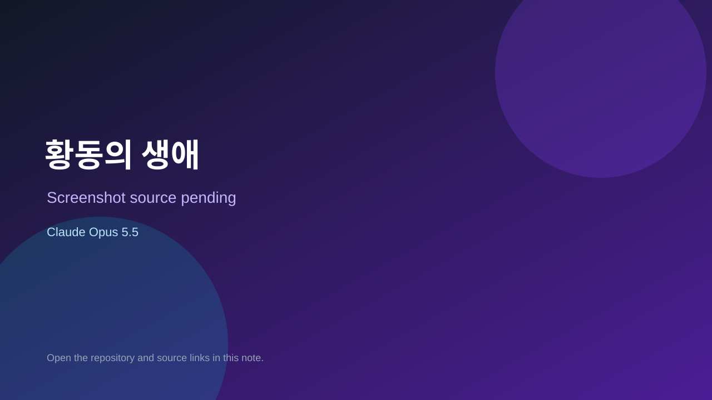

# 황동의 생애

> Verified game note.

## At a glance

- **Score:** 8.0/10
- **Model:** Claude Opus 5.5
- **Technology:** JavaScript, Browser
- **Estimated FP32 operations/s at 60 FPS:** 10,000,000 (low confidence; static estimate, not measured).
- **Rating basis:** Heuristic from source size, README and commit history (5.8 + 0.6*log10(code KB+1), +0.3 with a reachable demo); no runtime playtest.
- **Verified:** 2026-10-23
- **Repository:** [https://github.com/dniwndk/gamecode](https://github.com/dniwndk/gamecode)
- **Evidence:** [direct model evidence](https://github.com/dniwndk/gamecode/commit/743f299f5c6395fd2008a5f16dc6f57f28292a95)
- **Live demo:** [open demo](https://dniwndk.github.io/gamecode/)

## Screenshots

No screenshot source is recorded yet. Keep the placeholder until a repository, awesome list, or creator source provides an image.

## Model attribution

Open the evidence link above. Evidence grade: **direct model evidence**.

## Source description

마법공학 도시 에르덴(공력 184년)에서 한 시민의 열세 살부터 마지막 날까지를 사는 텍스트 생애 시뮬레이션. 설계는 design/plan.md. Commit carries an exact Claude Opus 5.5 co-author trailer. Live demo returned HTTP 200 (availability only, not a playtest). Source inspected from README, file tree and commit history only; no playtest.

### Gameplay source

- [https://github.com/dniwndk/gamecode/blob/main/.claude/skills/impeccable/scripts/live-browser.js](https://github.com/dniwndk/gamecode/blob/main/.claude/skills/impeccable/scripts/live-browser.js)
- [https://github.com/dniwndk/gamecode/commit/743f299f5c6395fd2008a5f16dc6f57f28292a95](https://github.com/dniwndk/gamecode/commit/743f299f5c6395fd2008a5f16dc6f57f28292a95)

## Verification notes

- **Status:** verified_source
- **Counted units in repository:** 1
- **Units covered by this note:** 1
- **Discovery:** GitHub commit pool: model+game commits 2026-10-21T01:00Z..2026-10-23T01:00Z (20-minute Opus 5.5 and wider other-model UTC partitions) joined to repositories created after 2026-10-20T01:00Z; https://github.com/dniwndk/gamecode

[Back to the awesome list](../../README.md)
