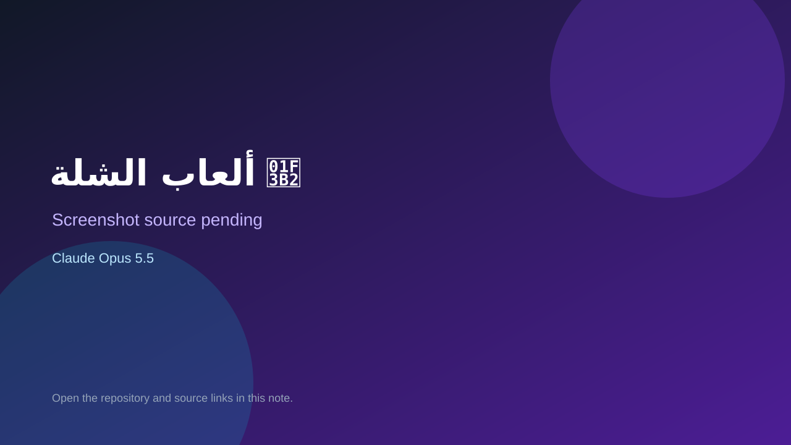

# ألعاب الشلة 🎲

> Verified game note.

## At a glance

- **Score:** 7.9/10
- **Model:** Claude Opus 5.5
- **Technology:** JavaScript, Browser
- **Estimated FP32 operations/s at 60 FPS:** 10,000,000 (low confidence; static estimate, not measured).
- **Rating basis:** Heuristic from source size, README and commit history (5.8 + 0.6*log10(code KB+1), +0.3 with a reachable demo); no runtime playtest.
- **Verified:** 2026-10-17
- **Repository:** [https://github.com/HadiTAG7/Games](https://github.com/HadiTAG7/Games)
- **Evidence:** [direct model evidence](https://github.com/HadiTAG7/Games/commit/04548ed73c189d3e0b988ffe72d98b2c034ceb38)
- **Live demo:** [open demo](https://herd-game-hf2y.onrender.com)
- **Additional live link:** [open demo](https://herd-game-hf2y.onrender.com/herd)
- **Additional live link:** [open demo](https://herd-game-hf2y.onrender.com/time)
- **Additional live link:** [open demo](https://herd-game-hf2y.onrender.com/seen)

## Screenshots

No screenshot source is recorded yet. Keep the placeholder until a repository, awesome list, or creator source provides an image.

## Model attribution

Open the evidence link above. Evidence grade: **direct model evidence**.

## Source description

ألعاب جماعية تنلعب من الجوال: المضيف يفتح غرفة على شاشة (لابتوب أو تلفزيون)، والكل يمسح الباركود ويدخل ويجاوب من جواله. Commit carries an exact Claude Opus 5.5 co-author trailer. Live demo returned HTTP 200 (availability only, not a playtest). Source inspected from README, file tree and commit history only; no playtest.

### Gameplay source

- [https://github.com/HadiTAG7/Games/blob/claude/group-quiz-game-u8o086/scripts/time_challenge_sources.py](https://github.com/HadiTAG7/Games/blob/claude/group-quiz-game-u8o086/scripts/time_challenge_sources.py)
- [https://github.com/HadiTAG7/Games/commit/04548ed73c189d3e0b988ffe72d98b2c034ceb38](https://github.com/HadiTAG7/Games/commit/04548ed73c189d3e0b988ffe72d98b2c034ceb38)

## Verification notes

- **Status:** verified_source
- **Counted units in repository:** 1
- **Units covered by this note:** 1
- **Discovery:** GitHub commit pool: model+game commits 2026-10-16..2026-10-17 (1-hour Opus, 3-hour Sonnet, 6-hour other UTC partitions) joined to repositories created after 2026-10-16T00:00Z; https://github.com/HadiTAG7/Games

[Back to the awesome list](../../README.md)
