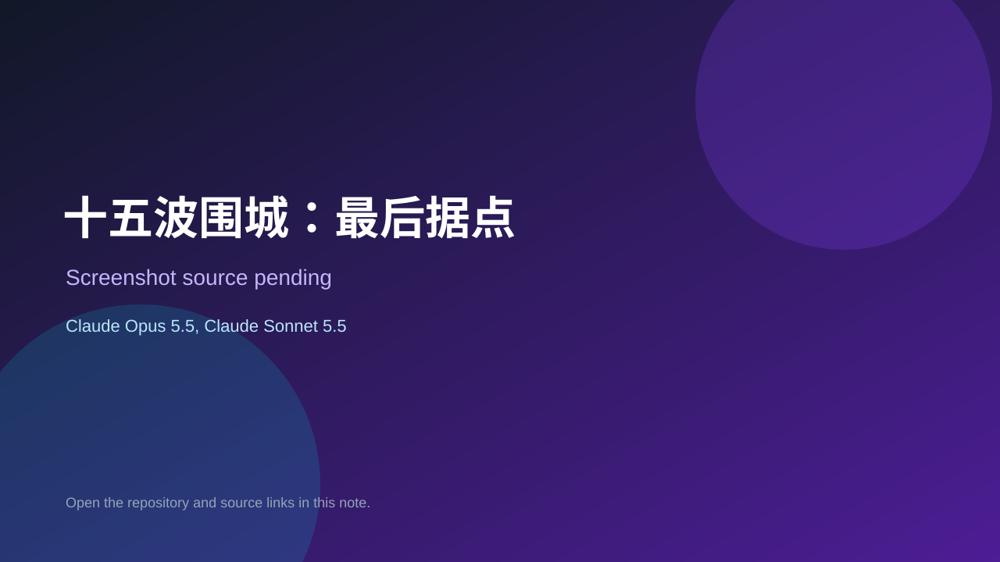

# 十五波围城：最后据点

> Verified game note.

## At a glance

- **Score:** 7.9/10
- **Model:** Claude Opus 5.5, Claude Sonnet 5.5
- **Technology:** JavaScript, Browser
- **Estimated FP32 operations/s at 60 FPS:** 10,000,000 (low confidence; static estimate, not measured).
- **Rating basis:** Heuristic from source size, README and commit history (5.8 + 0.6*log10(code KB+1), +0.3 with a reachable demo); no runtime playtest.
- **Verified:** 2026-10-23
- **Repository:** [https://github.com/hu-zhixuan/World-zombies-game](https://github.com/hu-zhixuan/World-zombies-game)
- **Evidence:** [direct model evidence](https://github.com/hu-zhixuan/World-zombies-game/commit/b96668c78c8efc45aaa79d65e521c38685b4d7c5)

## Screenshots

No screenshot source is recorded yet. Keep the placeholder until a repository, awesome list, or creator source provides an image.

## Model attribution

Open the evidence link above. Evidence grade: **direct model evidence**.

## Source description

单文件 HTML5 塔防 + 深夜食堂经营游戏。源码拆在 src/ 里，build.js 把它们纯拼接成一个可直接双击打开的 HTML。. Commit carries an exact Claude Opus 5.5 / Claude Sonnet 5.5 co-author trailer. Source inspected from README, file tree and commit history only; no playtest.

### Gameplay source

- [https://github.com/hu-zhixuan/World-zombies-game/blob/main/archive/zombie-game-v55.html](https://github.com/hu-zhixuan/World-zombies-game/blob/main/archive/zombie-game-v55.html)
- [https://github.com/hu-zhixuan/World-zombies-game/commit/b96668c78c8efc45aaa79d65e521c38685b4d7c5](https://github.com/hu-zhixuan/World-zombies-game/commit/b96668c78c8efc45aaa79d65e521c38685b4d7c5)

## Verification notes

- **Status:** verified_source
- **Counted units in repository:** 1
- **Units covered by this note:** 1
- **Discovery:** GitHub commit pool: model+game commits 2026-10-21T01:00Z..2026-10-23T01:00Z (20-minute Opus 5.5 and wider other-model UTC partitions) joined to repositories created after 2026-10-20T01:00Z; https://github.com/hu-zhixuan/World-zombies-game

[Back to the awesome list](../../README.md)
