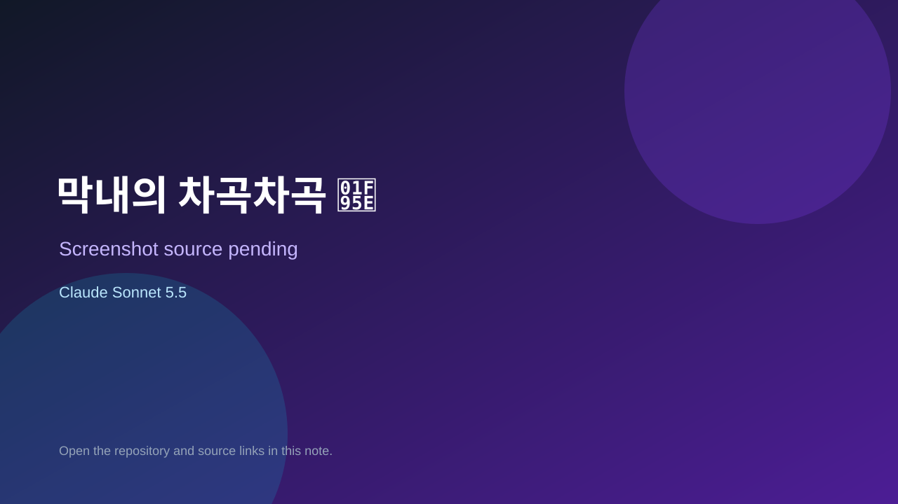

# 막내의 차곡차곡 🥞

> Verified game note.

## At a glance

- **Score:** 6.6/10
- **Model:** Claude Sonnet 5.5
- **Technology:** JavaScript, Browser
- **Estimated FP32 operations/s at 60 FPS:** 10,000,000 (low confidence; static estimate, not measured).
- **Rating basis:** Heuristic from source size, README and commit history (5.8 + 0.6*log10(code KB+1), +0.3 with a reachable demo); no runtime playtest.
- **Verified:** 2026-10-21
- **Repository:** [https://github.com/hye-rim/chagok-game](https://github.com/hye-rim/chagok-game)
- **Evidence:** [direct model evidence](https://github.com/hye-rim/chagok-game/commit/a4b4ab8bec740a2214b67e196a156dd8a71cb81f)

## Screenshots

No screenshot source is recorded yet. Keep the placeholder until a repository, awesome list, or creator source provides an image.

## Model attribution

Open the evidence link above. Evidence grade: **direct model evidence**.

## Source description

완성 그림을 보고 재료를 접시 맨 아래부터 똑같은 순서로 빠르게 쌓는 액션 퍼즐. 작은 오락실의 게임 중 하나. 의존성 없는 정적 게임(index.html + game.js)입니다. Commit carries an exact Claude Sonnet 5.5 co-author trailer. Source inspected from README, file tree and commit history only; no playtest.

### Gameplay source

- [https://github.com/hye-rim/chagok-game/blob/main/index.html](https://github.com/hye-rim/chagok-game/blob/main/index.html)
- [https://github.com/hye-rim/chagok-game/commit/a4b4ab8bec740a2214b67e196a156dd8a71cb81f](https://github.com/hye-rim/chagok-game/commit/a4b4ab8bec740a2214b67e196a156dd8a71cb81f)

## Verification notes

- **Status:** verified_source
- **Counted units in repository:** 1
- **Units covered by this note:** 1
- **Discovery:** GitHub commit pool: model+game commits 2026-10-17T01:00Z..2026-10-21T01:00Z (1-hour Opus, 3-hour Sonnet, 6-hour other UTC partitions) joined to repositories created after 2026-10-17T00:00Z; https://github.com/hye-rim/chagok-game

[Back to the awesome list](../../README.md)
