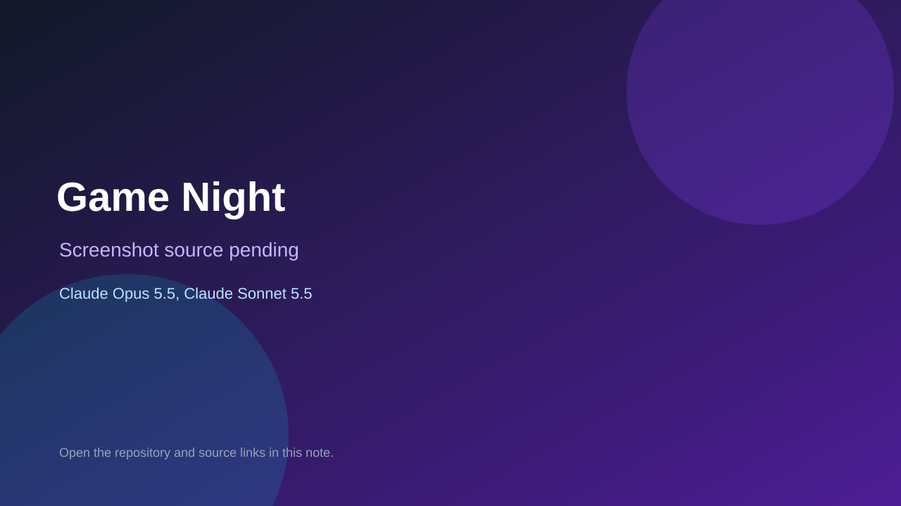

# Game Night

> Top-list entry: **today** (#7), **this week** (#9).

## At a glance

- **Score:** 8.0/10
- **Model:** Claude Opus 5.5, Claude Sonnet 5.5
- **Technology:** JavaScript, WebRTC, Browser
- **Estimated FP32 operations/s at 60 FPS:** 100,000,000 (low confidence; static estimate, not measured).
- **Rating basis:** Estimated from README, source tree and commit history; no runtime playtest.
- **Verified:** 2026-10-15
- **Repository:** [https://github.com/tomaras/game-night](https://github.com/tomaras/game-night)
- **Evidence:** [direct model evidence](https://github.com/tomaras/game-night/commit/11f018c36785936ce5458a23d8f432c2176027d2)
- **Live demo:** [open demo](https://squattersnights.fun/)

## Screenshots

No screenshot source is recorded yet. Keep the placeholder until a repository, awesome list, or creator source provides an image.

## Model attribution

Open the evidence link above. Evidence grade: **direct model evidence**.

## Source description

Serverless browser party-game hub advertising 52 multiplayer games with rooms, chat and voice/video, or play the computer; counted as one aggregate unit; commits co-author Claude Sonnet 5.5 and Claude Opus 5.5. Live demo returned HTTP 200 (availability only, not a playtest). Source inspected only; no playtest.

### Gameplay source

- [https://github.com/tomaras/game-night/blob/main/index.html](https://github.com/tomaras/game-night/blob/main/index.html)
- [https://github.com/tomaras/game-night/commit/11f018c36785936ce5458a23d8f432c2176027d2](https://github.com/tomaras/game-night/commit/11f018c36785936ce5458a23d8f432c2176027d2)

## Verification notes

- **Status:** verified_source_and_live_demo
- **Counted units in repository:** 1
- **Units covered by this note:** 1
- **Discovery:** GitHub commit pool: model+game commits 2026-10-08..2026-10-15 joined to repositories created after 2026-10-07T17:00Z; https://github.com/tomaras/game-night

[Back to the awesome list](../../README.md)
