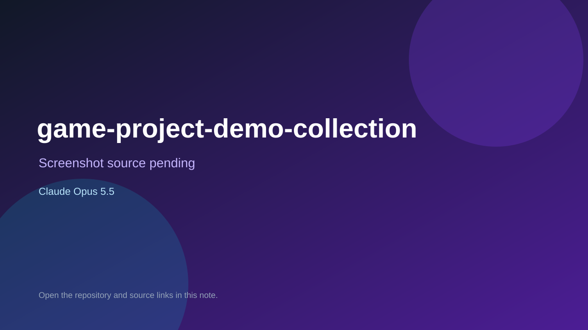

# game-project-demo-collection

> Verified game note.

## At a glance

- **Score:** 7.2/10
- **Model:** Claude Opus 5.5
- **Technology:** Flutter, Dart
- **Estimated FP32 operations/s at 60 FPS:** 1,000,000,000 (low confidence; static estimate, not measured).
- **Rating basis:** Heuristic from source size, README and commit history (5.8 + 0.6*log10(code KB+1), +0.3 with a reachable demo); no runtime playtest.
- **Verified:** 2026-10-21
- **Repository:** [https://github.com/JeongHunsss/game-project-demo-collection](https://github.com/JeongHunsss/game-project-demo-collection)
- **Evidence:** [direct model evidence](https://github.com/JeongHunsss/game-project-demo-collection/commit/c5083cef2213684aa35918a99883da5ce21b6b70)

## Screenshots

No screenshot source is recorded yet. Keep the placeholder until a repository, awesome list, or creator source provides an image.

## Model attribution

Open the evidence link above. Evidence grade: **direct model evidence**.

## Source description

심심할 때마다 떠오른 아이디어로 만드는 작은 게임 모음입니다. 플랫폼은 게임마다 다를 수 있고, 웹 게임은 설치 없이 브라우저에서 바로 실행됩니다. Commit carries an exact Claude Opus 5.5 co-author trailer. Source inspected from README, file tree and commit history only; no playtest.

### Gameplay source

- [https://github.com/JeongHunsss/game-project-demo-collection/blob/main/shout_phalanx/game.js](https://github.com/JeongHunsss/game-project-demo-collection/blob/main/shout_phalanx/game.js)
- [https://github.com/JeongHunsss/game-project-demo-collection/commit/c5083cef2213684aa35918a99883da5ce21b6b70](https://github.com/JeongHunsss/game-project-demo-collection/commit/c5083cef2213684aa35918a99883da5ce21b6b70)

## Verification notes

- **Status:** verified_source
- **Counted units in repository:** 1
- **Units covered by this note:** 1
- **Discovery:** GitHub commit pool: model+game commits 2026-10-17T01:00Z..2026-10-21T01:00Z (1-hour Opus, 3-hour Sonnet, 6-hour other UTC partitions) joined to repositories created after 2026-10-17T00:00Z; https://github.com/JeongHunsss/game-project-demo-collection

[Back to the awesome list](../../README.md)
