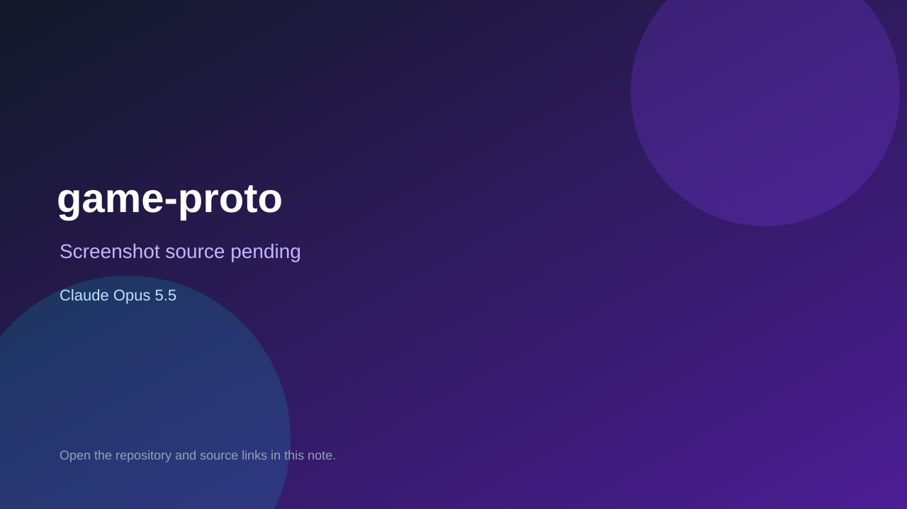

# game-proto

> Verified game note.

## At a glance

- **Score:** 7.4/10
- **Model:** Claude Opus 5.5
- **Technology:** TypeScript, Phaser, Browser
- **Estimated FP32 operations/s at 60 FPS:** 100,000,000 (low confidence; static estimate, not measured).
- **Rating basis:** Estimated from README, source tree and commit history; no runtime playtest.
- **Verified:** 2026-10-15
- **Repository:** [https://github.com/Chriszly/game-proto](https://github.com/Chriszly/game-proto)
- **Evidence:** [direct model evidence](https://github.com/Chriszly/game-proto/commit/b32159346176ef19b0f93912de5b000d1c596f84)

## Screenshots

No screenshot source is recorded yet. Keep the placeholder until a repository, awesome list, or creator source provides an image.

## Model attribution

Open the evidence link above. Evidence grade: **direct model evidence**.

## Source description

Hub of small Phaser 4 game prototypes (for example Apothecary and Beehive Baron), each in games/; counted as one aggregate unit; Claude Opus 5.5 trailers. Source inspected only; no playtest.

### Gameplay source

- [https://github.com/Chriszly/game-proto/blob/main/e2e/hub.spec.ts](https://github.com/Chriszly/game-proto/blob/main/e2e/hub.spec.ts)
- [https://github.com/Chriszly/game-proto/commit/b32159346176ef19b0f93912de5b000d1c596f84](https://github.com/Chriszly/game-proto/commit/b32159346176ef19b0f93912de5b000d1c596f84)

## Verification notes

- **Status:** verified_source
- **Counted units in repository:** 1
- **Units covered by this note:** 1
- **Discovery:** GitHub commit pool: model+game commits 2026-10-08..2026-10-15 joined to repositories created after 2026-10-07T17:00Z; https://github.com/Chriszly/game-proto

[Back to the awesome list](../../README.md)
