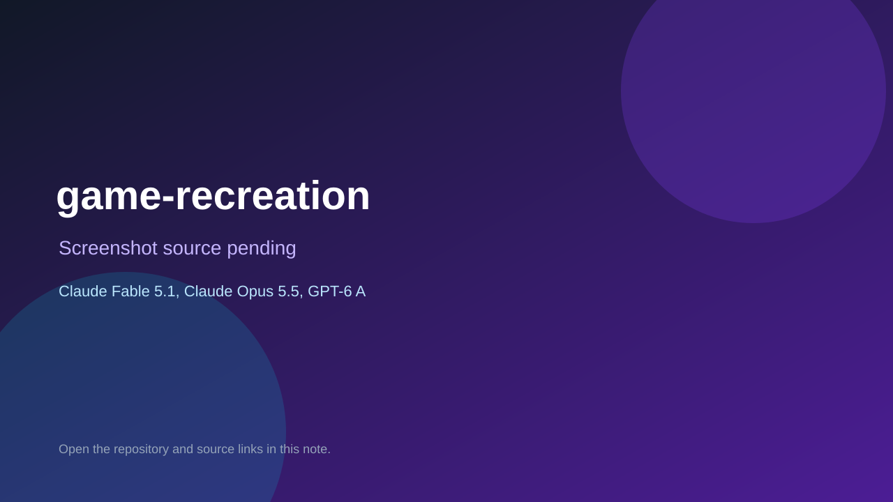

# game-recreation

> Verified game note.

## At a glance

- **Score:** 7.4/10
- **Model:** Claude Fable 5.1, Claude Opus 5.5, GPT-6 Astra
- **Technology:** JavaScript, Three.js, Browser
- **Estimated FP32 operations/s at 60 FPS:** 1,000,000,000 (low confidence; static estimate, not measured).
- **Rating basis:** Estimated from README, source tree and commit history; no runtime playtest.
- **Verified:** 2026-10-15
- **Repository:** [https://github.com/alisafakaya624-coder/game-recreation](https://github.com/alisafakaya624-coder/game-recreation)
- **Evidence:** [directory-method model evidence](https://github.com/alisafakaya624-coder/game-recreation/commit/b52fd7cbf131344af466f5e497a4423466fa1122)

## Screenshots

No screenshot source is recorded yet. Keep the placeholder until a repository, awesome list, or creator source provides an image.

## Model attribution

Open the evidence link above. Evidence grade: **directory-method model evidence**.

## Source description

Collection of one-shot browser game recreations grouped by model folder (fable-5.1, opus-5.5, gpt-6-astra) with the prompts used; model labels come from folder names and commit text. Counted as one aggregate unit. Source inspected only; no playtest.

### Gameplay source

- [https://github.com/alisafakaya624-coder/game-recreation/blob/main/games/fable-5.1/GTA6-Leonida.html](https://github.com/alisafakaya624-coder/game-recreation/blob/main/games/fable-5.1/GTA6-Leonida.html)
- [https://github.com/alisafakaya624-coder/game-recreation/commit/b52fd7cbf131344af466f5e497a4423466fa1122](https://github.com/alisafakaya624-coder/game-recreation/commit/b52fd7cbf131344af466f5e497a4423466fa1122)

## Verification notes

- **Status:** verified_source
- **Counted units in repository:** 1
- **Units covered by this note:** 1
- **Discovery:** GitHub commit pool: model+game commits 2026-10-08..2026-10-15 joined to repositories created after 2026-10-07T17:00Z; https://github.com/alisafakaya624-coder/game-recreation

[Back to the awesome list](../../README.md)
