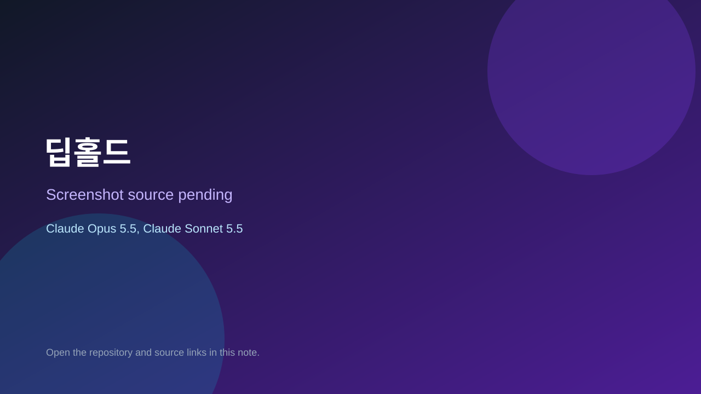

# 딥홀드

> Verified game note.

## At a glance

- **Score:** 8.1/10
- **Model:** Claude Opus 5.5, Claude Sonnet 5.5
- **Technology:** TypeScript, Phaser, Browser
- **Estimated FP32 operations/s at 60 FPS:** 100,000,000 (low confidence; static estimate, not measured).
- **Rating basis:** Heuristic from source size, README and commit history (5.8 + 0.6*log10(code KB+1), +0.3 with a reachable demo); no runtime playtest.
- **Verified:** 2026-10-17
- **Repository:** [https://github.com/starMinK/deephold](https://github.com/starMinK/deephold)
- **Evidence:** [direct model evidence](https://github.com/starMinK/deephold/commit/0ec81e6d8c01f2a89f878274eb3ee70f197d2f78)

## Screenshots

No screenshot source is recorded yet. Keep the placeholder until a repository, awesome list, or creator source provides an image.

## Model attribution

Open the evidence link above. Evidence grade: **direct model evidence**.

## Source description

던전을 파밍하고, 내 던전을 짓고, 친구가 도전하는 2.5D 도트 액션 (TypeScript + Phaser 3). Commit carries an exact Claude Opus 5.5 / Claude Sonnet 5.5 co-author trailer. Source inspected from README, file tree and commit history only; no playtest.

### Gameplay source

- [https://github.com/starMinK/deephold/blob/main/dist-server/server.mjs](https://github.com/starMinK/deephold/blob/main/dist-server/server.mjs)
- [https://github.com/starMinK/deephold/commit/0ec81e6d8c01f2a89f878274eb3ee70f197d2f78](https://github.com/starMinK/deephold/commit/0ec81e6d8c01f2a89f878274eb3ee70f197d2f78)

## Verification notes

- **Status:** verified_source
- **Counted units in repository:** 1
- **Units covered by this note:** 1
- **Discovery:** GitHub commit pool: model+game commits 2026-10-16..2026-10-17 (1-hour Opus, 3-hour Sonnet, 6-hour other UTC partitions) joined to repositories created after 2026-10-16T00:00Z; https://github.com/starMinK/deephold

[Back to the awesome list](../../README.md)
